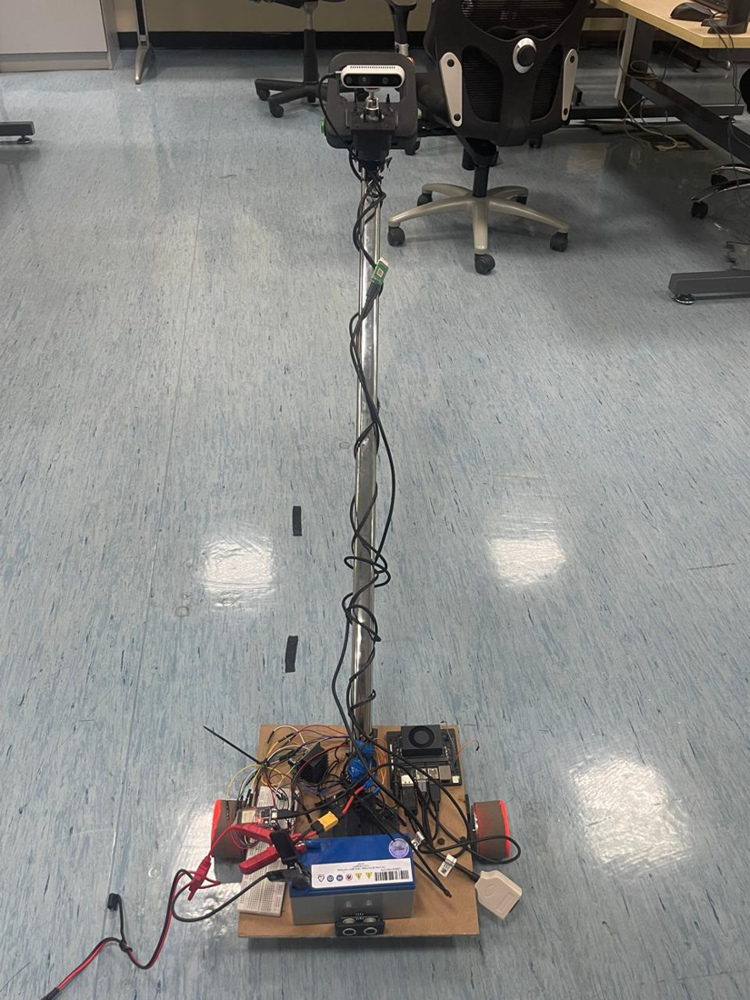
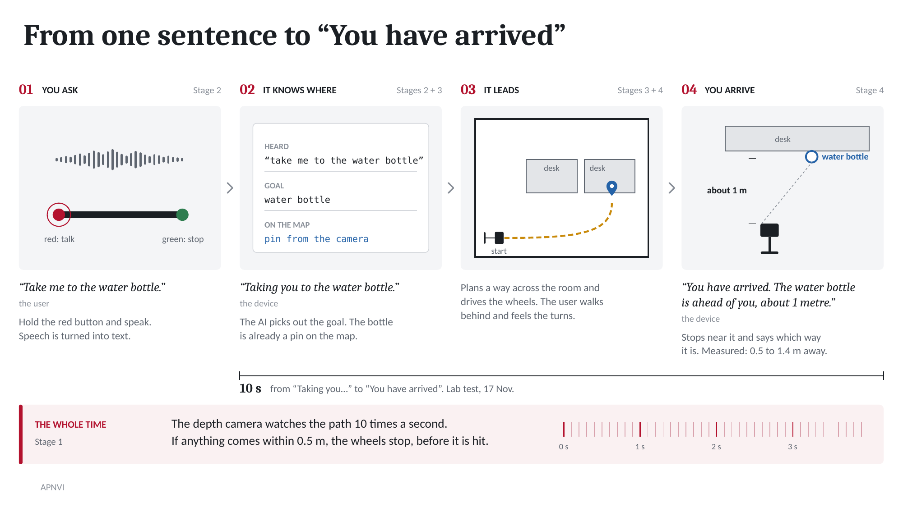
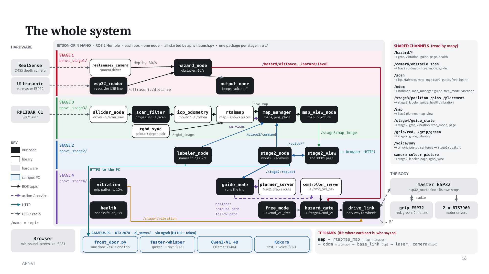
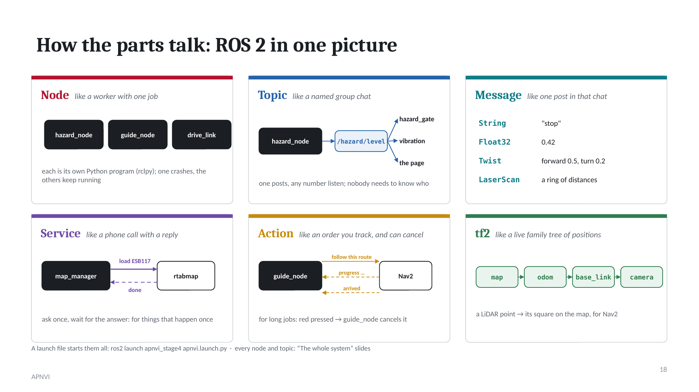
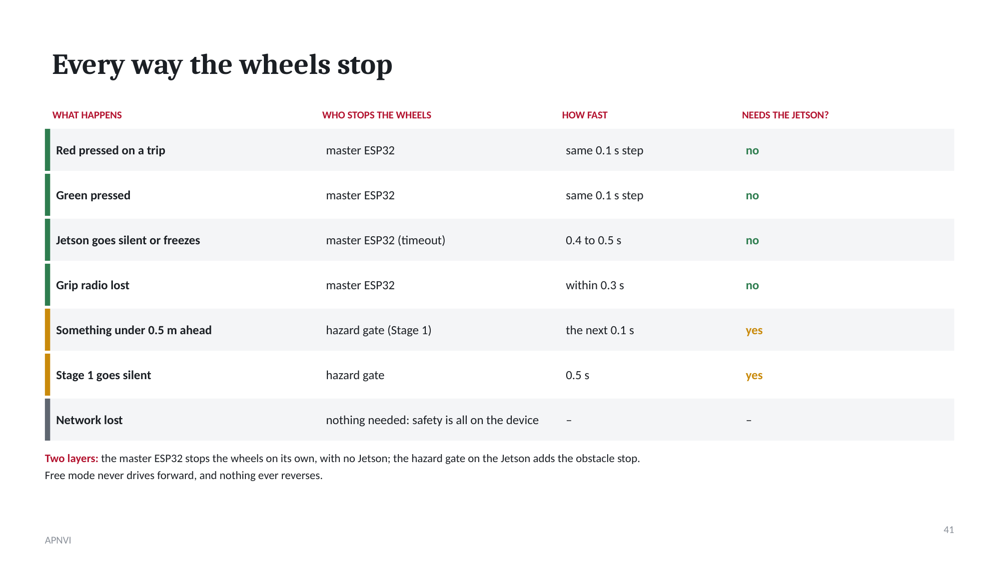
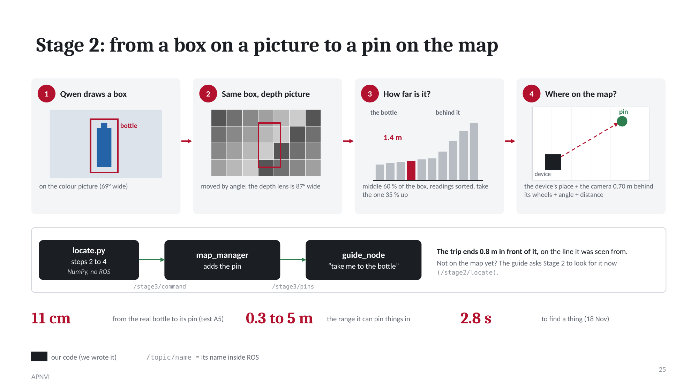
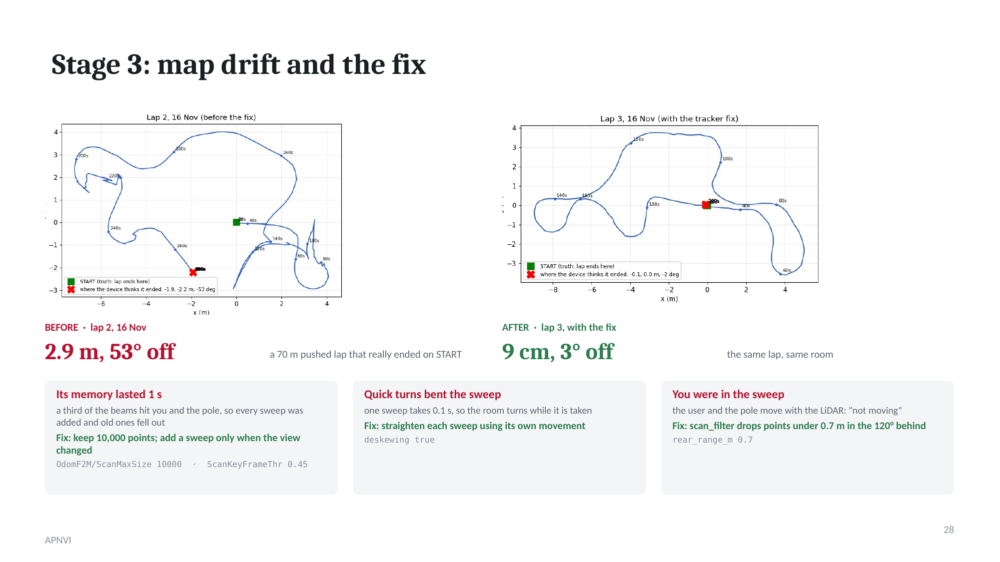
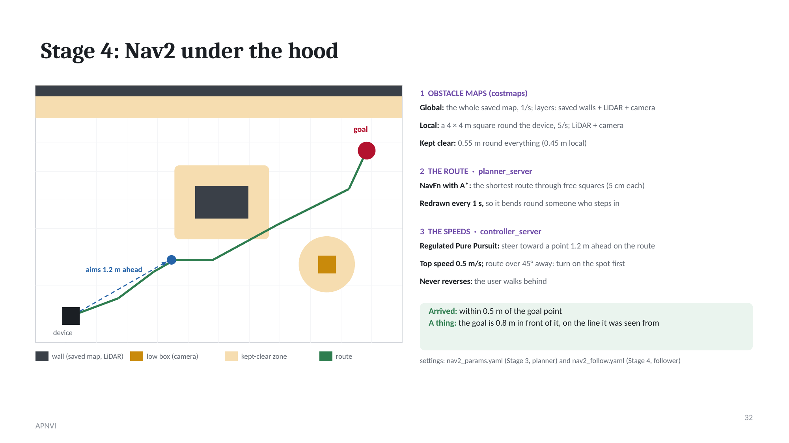
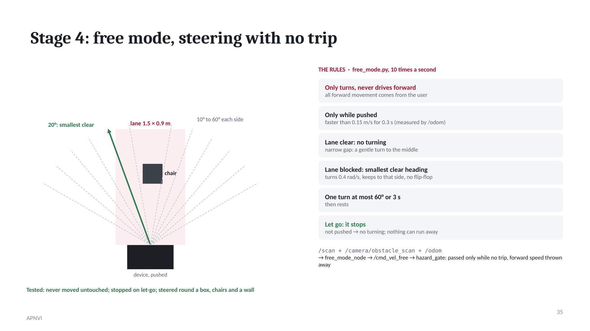

# APNVI: Assistive Perception and Navigation for the Visually Impaired

**A robotic guide cane that maps buildings it has never seen, understands spoken requests, and physically leads a blind user to where they want to go.**

<p align="center">
  
</p>

A user holds a button and says *"take me to the water bottle."* APNVI finds the bottle with its camera, pins it on a map it built itself, plans a route, and pulls the user there on two motorized wheels, stopping for anything in the way. On arrival it says *"You have arrived. The water bottle is ahead of you, about 1 metre."*



Built at the American University of Sharjah as a senior design project (2026), and planned for continued development as a non-profit.

---

## Highlights

| | |
|---|---|
| **End to end on real hardware** | Speech, vision, mapping, route planning, motor control and haptics run as one system on a Jetson Orin Nano. The full demo was completed blindfolded, with nobody at the keyboard. |
| **No setup in the building** | The device maps a room as it moves, saves the map by name, finds itself on it later, and labels signs and landmarks by itself. |
| **Safety in layers** | The obstacle check runs 10 times a second, the stop buttons cut wheel power within 0.1 s, and the motor controller stops the wheels on its own within 0.5 s if the main computer goes silent. |
| **Accurate** | Every guided run ended within 0.5 m of its goal. Position error after a full lap was 0.09 m (target 0.3 m), and found objects were placed within 0.11 m. |
| **Engineered to last** | About 24,000 lines of code across Python, C++ (ESP32) and shell, with 580+ automated tests that run without any hardware, a ROS 2 stand-in for whole-chain simulation, and an operator console. |
| **Low cost** | About 1,685 AED in purchased parts, using open-source AI models. |

## Architecture



APNVI is built in four stages, each a ROS 2 package. Each stage was proven on the device before the next one began.

| Stage | Package | What it does |
|---|---|---|
| 1. Obstacle warning | [`apnvi_stage1`](src/apnvi_stage1) | Fuses the RealSense D435 depth image and an ultrasonic sensor into one hazard level, 10 times a second |
| 2. Perception and voice | [`apnvi_stage2`](src/apnvi_stage2) | Hold-to-talk speech (faster-whisper), intent sorting, object finding and sign reading with a vision-language model (Qwen3-VL), natural voice (Kokoro), self-labelling of the map |
| 3. Mapping and localization | [`apnvi_stage3`](src/apnvi_stage3) | RPLIDAR C1 with ICP odometry and RTAB-Map, a custom map manager (named maps, pins, relocalization on a saved map), route planning with Nav2 |
| 4. Guidance | [`apnvi_stage4`](src/apnvi_stage4) | Trip state machine, hazard gate between the planner and the wheels, free-mode steering, getting unstuck, health monitoring, grip vibration signals, serial link to the motor controller |

Around the four packages:

| Folder | What is in it |
|---|---|
| [`ai_server/`](ai_server) | GPU server for speech-to-text, text-to-speech and the vision-language model, plus a token-protected front door so the device can reach it over the internet through a Cloudflare tunnel |
| [`firmware/`](firmware) | ESP32 firmware: the motor master (with its own independent stop logic and a link watchdog) and the sensor board. The grip talks to the master over ESP-NOW. |
| [`console/`](console) | Operator console: one-press "Get ready" from a cold start, live mapping, and one-press recovery for known faults |
| [`device/`](device) | Start/stop scripts, the systemd service, and session tools (`health`, `where`, `record`) |
| [`sim/`](sim) | A lightweight ROS 2 stand-in that runs the real Stage 2 to 4 programs together on any computer, with simulated sensors |
| [`tools/`](tools) | LiDAR odometry replay and evaluation, load-test logging, placement checks, offline finder and labeller tryouts |
| [`jetson_setup/`](jetson_setup) | One-shot Jetson setup (ROS 2 Humble, drivers, build) and a patch for a tf2 deadlock that silently ended every Nav2 trip |
| [`docs/`](docs) | System design, test results, architecture diagrams and an interactive code map |

## Diagrams

A selection from the [41 architecture diagrams](docs/slides/README.md):

<table>
<tr>
<td width="50%"><a href="docs/slides/18-how-the-parts-talk-ros-2-in-one-picture.png"></a><br><sub>How the parts talk: ROS 2 in one picture</sub></td>
<td width="50%"><a href="docs/slides/41-every-way-the-wheels-stop.png"></a><br><sub>Every way the wheels stop</sub></td>
</tr>
<tr>
<td><a href="docs/slides/25-stage-2-from-a-box-on-a-picture-to-a-pin-on-the-ma.png"></a><br><sub>Stage 2: from a box on a picture to a pin on the map</sub></td>
<td><a href="docs/slides/28-stage-3-map-drift-and-the-fix.png"></a><br><sub>Stage 3: map drift and the fix</sub></td>
</tr>
<tr>
<td><a href="docs/slides/32-stage-4-nav2-under-the-hood.png"></a><br><sub>Stage 4: Nav2 under the hood</sub></td>
<td><a href="docs/slides/35-stage-4-free-mode-steering-with-no-trip.png"></a><br><sub>Stage 4: free mode, steering with no trip</sub></td>
</tr>
</table>

## Tech stack

**Compute:** NVIDIA Jetson Orin Nano (on the device), a GPU PC for the AI models, 3 × ESP32
**Sensors:** Intel RealSense D435, Slamtec RPLIDAR C1, ultrasonic sensor
**Robotics:** ROS 2 Humble, RTAB-Map, Nav2 (Regulated Pure Pursuit), ICP odometry
**AI:** Qwen3-VL (via Ollama), faster-whisper, Kokoro TTS
**Actuation:** 2 DC motors on BTS7960 drivers, 2 vibration motors in the grip
**Other:** Python, C++ (Arduino/ESP32), OpenCV, NumPy, ESP-NOW, systemd, Cloudflare Tunnel

## Results

| Test | Result |
|---|---|
| Guided runs to a taped goal | 6 of 6 ended 0.10 to 0.45 m from the goal (limit 0.5 m) |
| Position after a full lap of the room | 0.09 m and 3° off (target 0.3 m) |
| "Take me to the water bottle" | Bottle placed within 0.11 m; both trips ended in front of it |
| A person steps in front of the device | Stopped every time, never touched anyone |
| Stage 1 rate under full load | 10 Hz held in every load test (Jetson at 41% CPU, 2.6 GB RAM, 7.4 W) |
| Stop buttons | Wheel power cut within 0.1 s; watchdog stop 0.4 to 0.5 s after the main computer goes silent |
| Self-labelling of the map | 3 of 6 landmarks pinned automatically, 0 pinned in the wrong place |
| Full demo, blindfolded | Completed in 9 minutes, with nobody at the keyboard |

The full write-up is in [`docs/results.md`](docs/results.md). It also covers the hardest problems met during the build (map drift, relocalization on a saved map, radio dropouts) and how each was solved.

## Documentation

- [System design](docs/system-design.md): hardware, software entities, interfaces, algorithms, the user interface, and the design decisions made during the build
- [Testing and results](docs/results.md): unit, integration, hardware and floor tests, performance, problems and fixes, limitations
- [Architecture diagrams](docs/slides/README.md): 41 diagrams, from the whole system down to each stage's internals
- [Final presentation (PDF)](docs/APNVI-presentation.pdf): the full 45-slide deck, including the technical backup slides
- [Interactive code map](docs/code-map.html): every node, topic and file, searchable (download and open in a browser)

## Running it

**Tests, without any hardware** (Python 3.10+, `pip install numpy opencv-python pyyaml pytest`):

```bash
P=$PWD/sim/rosstub; for i in 1 2 3 4; do P=$P:$PWD/src/apnvi_stage$i; done
for i in 1 2 3 4; do (cd src/apnvi_stage$i && PYTHONPATH=$P python3 -m pytest -q --ignore=test/test_flake8.py --ignore=test/test_pep257.py --ignore=test/test_copyright.py); done
PYTHONPATH=$P python3 sim/chain_test.py
```

**On the device** (Jetson Orin Nano, JetPack 6.2, Ubuntu 22.04):

```bash
git clone https://github.com/adelahmad2005/apnvi-smart-cane.git ~/apnvi_demo/src/apnvi-smart-cane
bash ~/apnvi_demo/src/apnvi-smart-cane/jetson_setup/jetson_setup.sh
```

Then set up the AI server on a GPU PC ([`ai_server/README.md`](ai_server/README.md)), flash the ESP32s ([`firmware/`](firmware)), and start the device with [`device/start.sh`](device/README.md).

## Status and what comes next

APNVI is a working proof of concept, tested by the team in the lab. The next steps are:

- Trials with visually impaired users
- Wheel encoders or an IMU, to remove map drift when turning on the spot
- Running the AI models on the device, so it doesn't need a helper PC
- Production hardware: a sealed grip connector, a proper power system and an enclosure

Known limitations are listed in [`docs/results.md`](docs/results.md#limitations-and-remaining-work).

## Team

- **Adel Abdelmoaty**: system architect and integration lead
- **Mo'ath Malkawi**: computer vision and perception
- **Abdullah Siddiqui**: sensors, firmware, haptics and motor control
- **Hamed Mahmood**: hardware, mechanical design and ESP32 communication

Advisor: Dr. Michel Pasquier. Senior Design coordinator: Dr. Raafat Abu Rukba. American University of Sharjah.

## License

[MIT](LICENSE)
