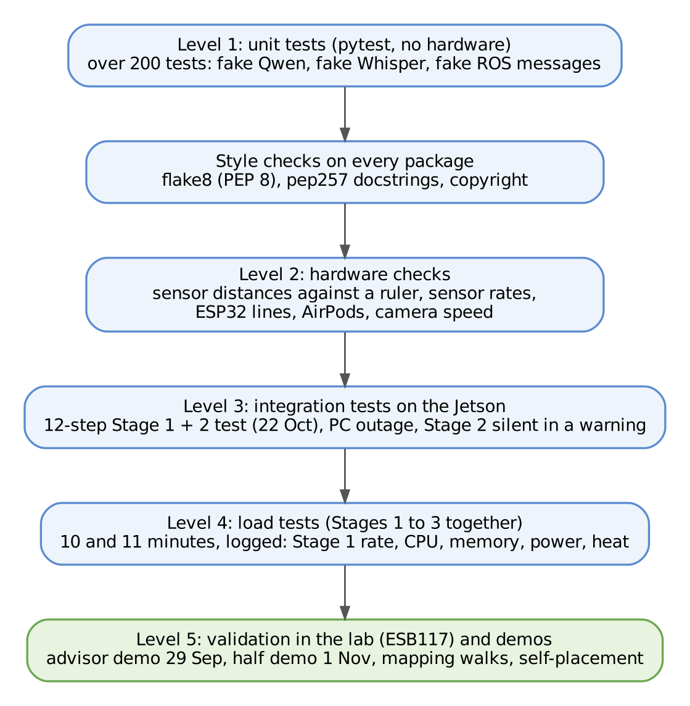
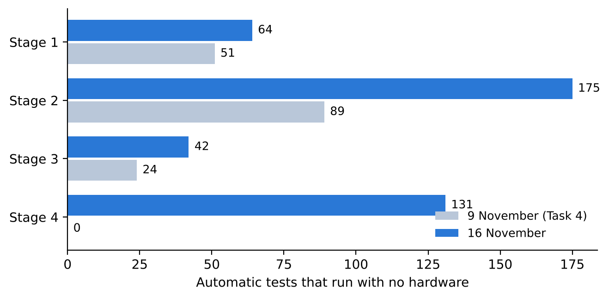
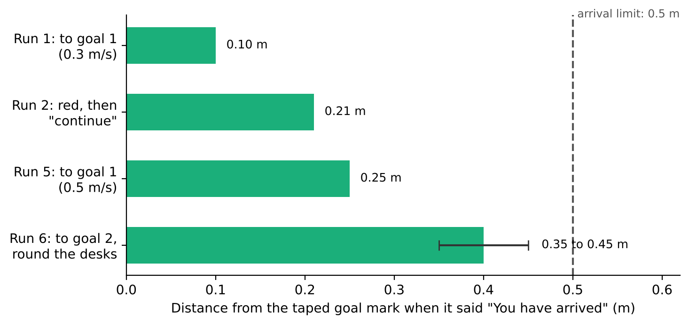
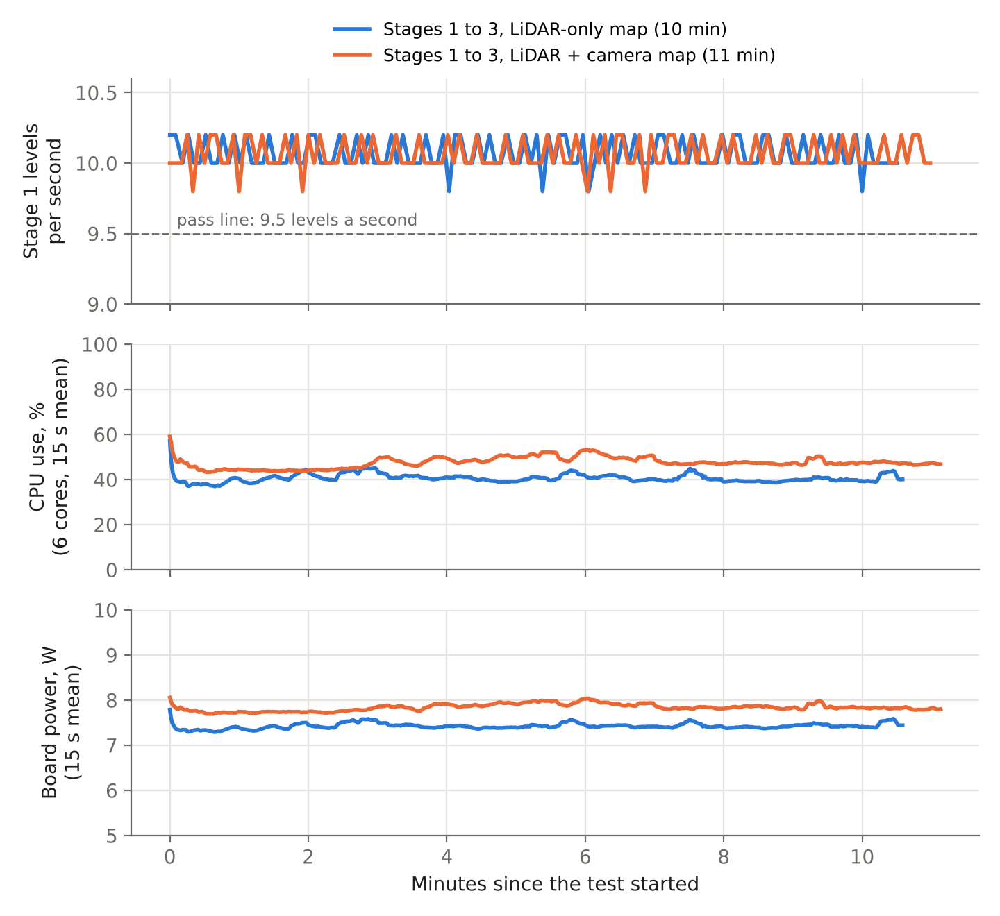
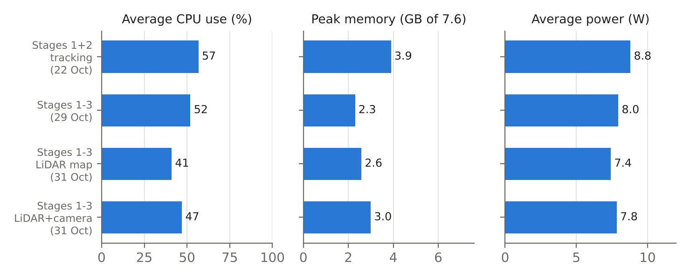
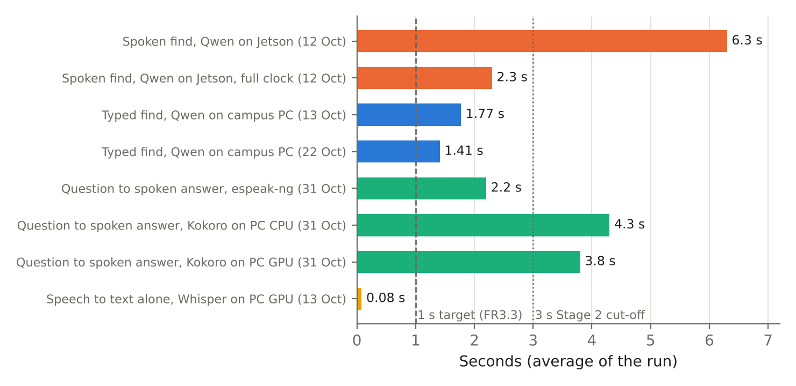
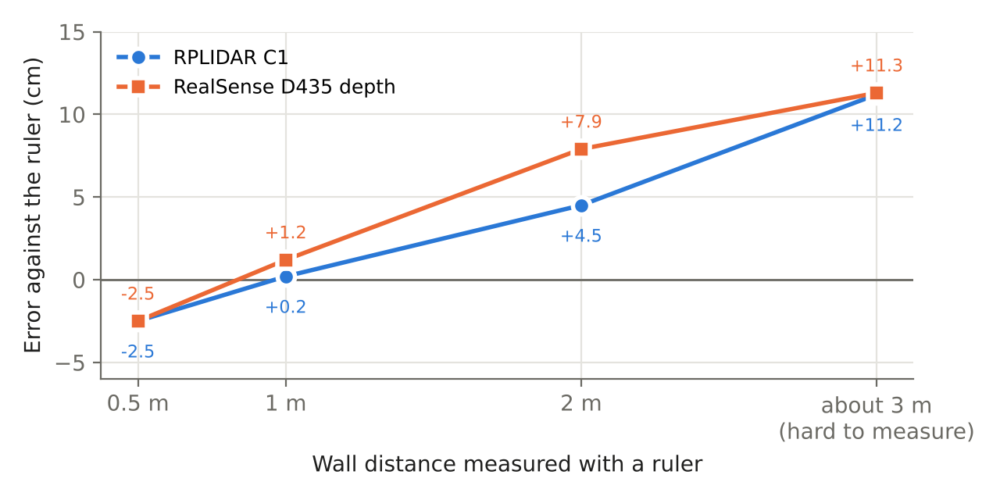
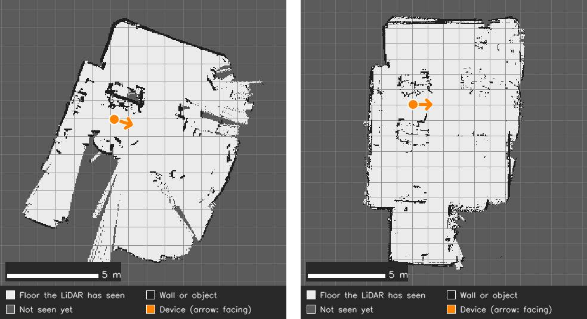
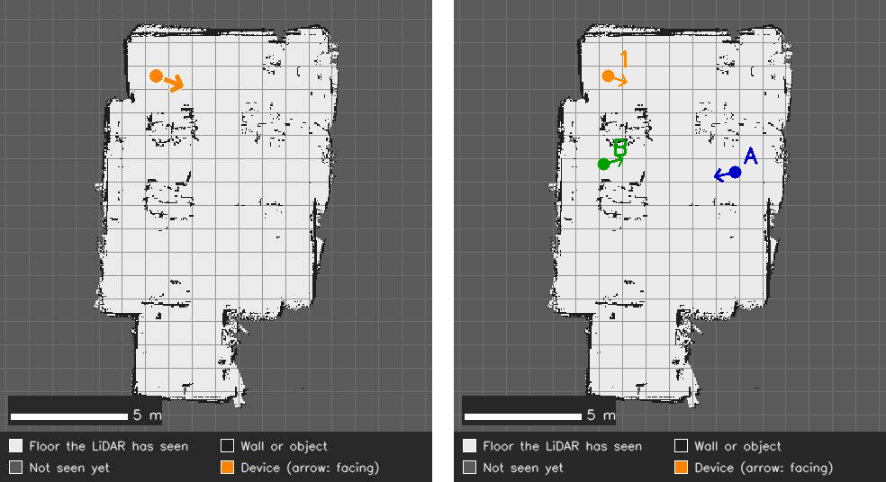
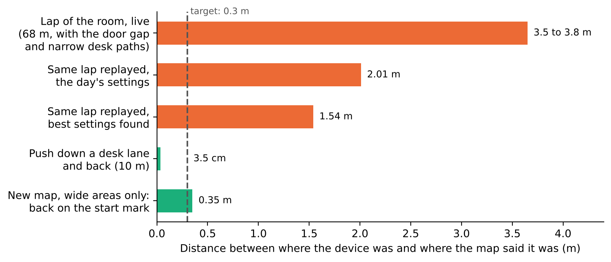

# Testing and Results

How APNVI was tested and what the tests showed. Verification asks whether each part was built right; validation asks whether the device does the job the user needs. It ends with the measured results against the design targets, the hardest problems met and how they were solved, and the known limitations.

## Testing Approach

Testing was mostly black-box tests of what the user would notice, plus white-box checks on the parts where timing matters. The team tested in five levels, from small to large (Figure 1). Every package has automatic tests that run with no hardware, using made-up stand-ins for Qwen, Whisper, the voice server, the microphone and the ROS messages. Each package is also checked for code style (flake8 for PEP 8 and pep257 for comments). The hardware checks and the integration tests then ran on the Jetson, and load tests logged the Stage 1 rate, processor, memory, power and heat once a second with tegrastats and the team's own logger. The last level was the lab and the demos.

*Figure 1. The Five Test Levels Used in the build*

Safety came first in the order of testing, as planned: the Stage 1 rate is checked in every load test, and a test fails if Stage 1 drops under 9.5 levels a second in any 5-second window. The negative cases were tested on purpose: an unreachable PC, a covered camera, no words heard, and a thing that is not in view.

Stage 4 moves a device that a person is holding, so it was tested on a ladder of five steps, and a step was only started after the one before it had passed. Step 0 uploaded the master's program with the 12 V battery unplugged, so that no wheel could move while every command and every stop rule was tried. Step 1 ran the wheels in the air, with the base on blocks. Step 2 was the first guided run on the floor, with a sighted teammate on the handle. Step 3 adds obstacles. Steps 4 and 5 repeat steps 2 and 3 with a blindfolded teammate and a helper walking alongside. One rule held throughout: the wheels were never driven unless someone was at the device with the green button in reach.

The parts written on 15 and 16 November were written away from the lab. Before they went on the device they were run as one chain on an ordinary computer, with a stand-in for ROS, a made-up camera and LiDAR, and a made-up AI that "sees" a door, a sign and a bottle. This cannot show that the hardware behaves, but it shows that the programs hand the right messages to each other.

## Verification

### Unit Testing

Table 1 lists the automatic tests, and Figure 2 shows how they grew. On 16 November the tests that can run without ROS were run on a clean computer: 412 passed, 1 was skipped, and none failed. One test file of Stage 4 needs ROS 2 itself and runs only on the Jetson. On the Jetson itself, with ROS, the full run gave 435 tests with no errors and no failures on 16 November. The fixes made during the lab tests of 17 November added tests, and all of them passed on the Jetson again: 68 for Stage 1, 185 for Stage 2, 55 for Stage 3 and 166 for Stage 4. Every rule that decides something sits in a plain Python file and has its own tests: when the hazard gate blocks, which vibration signal plays, where a found thing lands on the map, when two names mean the same thing, and when free mode may turn.

| **Package** | **What the tests check** | **Result (16 November, no ROS)** |
|-------------------|---------------------------------|---------------------|
| apnvi_stage1 | Path mask, nearest distance, levels and dead zone, blocked camera, side warning and ICP, ESP32 line parsing, beep timing, a tilted camera | 64 passed |
| apnvi_stage2 | Box reading and scaling, FIND or ANSWER sorting, sentences, follower, voice priority, page drawing; placing a thing on the map, the labeller's rules, map commands by voice, sound through the browser | 175 passed, 1 skipped |
| apnvi_stage3 | Map names and files, map picture, relocalizer search, launch settings; pins, names that mean the same, the user behind the LiDAR | 42 passed |
| apnvi_stage4 | Speed to wheel power, the master's report lines, the hazard gate, the guide's states and sentences, goals for things, vibration signals, free mode steering, health, launch settings | 131 passed |
| campus_pc servers | Speech and voice servers with made-up engines: replies, bad requests, errors, room codes said like people say them | 19 passed (9 November) |

*Table 1. Automatic Unit Tests*

*Figure 2. Automatic Tests per Package on 9 and 16 November*

### Integration Testing

The main integration test ran on 22 October on the new Jetson, with Stages 1 and 2 together and the PC on the hotspot (Table 2). Six of the twelve steps passed outright and three passed in part. Two problems still need fixing. With the camera covered, the status turned to "blocked" after 0.6 s but the level still said "clear". The side walk test showed walks from the left as "right". Step 12 could not be run then because there was no microphone. It was covered later by the AirPods tests on 26 October.

| **Step** | **Check**                       | **Result** | **Numbers**                                                               |
|------|---------------------|-----------|-----------------------------------|
| 1        | Clean start and build           | Pass       | No node died                                                              |
| 2        | Board facts                     | Pass       | JetPack 6.2, 25 W mode, USB 3, ESP32 plugged in                           |
| 3        | Network to the PC               | Partly     | HTTP to the PC: 37.8 ms average, 80.2 ms worst; ping blocked              |
| 4        | Rates with nobody watching      | Problem    | Colour 20.6 to 21.6 a second (want about 30); Stage 1 9.99                |
| 5        | Ten typed questions             | Pass       | 1.21 s best, 1.41 s average, 1.76 s worst                                 |
| 6        | Tracking "chair" for 10 minutes | Pass       | 633 answers, no throttling, 56.1 C worst, memory flat                     |
| 7        | Camera covered                  | Partly     | Blocked after 0.6 s, but the level said "clear"                           |
| 8        | Stage 2 silent during a warning | Pass       | Log: Stage 1 is at "stop": not saying ...                                 |
| 9        | Side walks and turning          | Fail       | Walks from the left shown as "right"; one false "left" in 10 s of turning |
| 10       | Tracking a hand                 | Partly     | Follows slow movement, loses a fast hand                                  |
| 11       | PC unreachable for 37 s         | Pass       | Stage 1 at 10.0 a second; message after 18.5 s; answers back at once      |
| 12       | Button and microphone           | Not tested | No microphone that day (AirPods tested 26 Oct)                            |

*Table 2. Results of the Stage 1 and Stage 2 Integration Test (22 October)*

Stage 4 was joined to the first three stages one step at a time, each step proven before the next. Table 3 gives the result of each step so far.

| **Step** | **What was checked** | **Result** | **Numbers** |
|------|---------------------|-----------|-----------------------------------|
| 0 (12 Nov) | Master program with the 12 V unplugged: every command and stop rule | Pass | Red stops at once and clears 0.30 s after release; green stops at once; Jetson silent: stop after 0.4 to 0.5 s |
| 1 (12 and 13 Nov) | Wheels in the air: direction, turning, the stops, the hazard stop, vibration | Pass | Both wheels equal; 27.5 turns in 10 s at full power; no USB drop in 2.5 minutes of driving; Stage 1 at 10.0 a second |
| 2 (15 Nov) | Guided runs on the floor in ESB117, sighted teammate | Pass after 7 fixes | Six runs, every arrival within 0.5 m (Table 6) |
| 3 | The same with obstacles: a person, a box, a gap between two chairs | Pass (17 Nov) | Stopped for a person every time and never touched them; round a box at two spots, arrived in 9 s; through a 1.2 m gap (Table 7) |
| 4 and 5 | Blindfolded user | Pass, one run (18 Nov) | The whole demo script with the user's eyes closed: two trips by voice, free mode, a spoken answer. The second run and the helper alongside were not done |

*Table 3. Results of the Stage 4 Test Ladder*

Table 4 gives the whole-chain test of 16 November, run on an ordinary computer with made-up sensors. It was run in two parts. In steps 1 to 11 the map manager, Stage 2, the labeller, the guide, the vibration program and the health program were running and wired to each other. In steps 12 and 13 free mode steering, the hazard gate and the vibration program were. Every step gave the expected result and no program reported an error. The test is kept with the code and can be run again on any computer.

| **Step** | **What was done** | **What the device did** |
|------|--------------------------|-----------------------------------|
| 1 | Start | Said "Ready" |
| 2 | Moved 0.6 m between two looks | Pinned the door (a thing) and "ESB117" (a room) after the second look |
| 3 | "Take me to the door" | "Taking you to the door"; goal 0.8 m in front of the door |
| 4 | Position moved to the goal | "You have arrived. The door is ahead of you, about 1 metre"; the arrived signal in the grip |
| 5 | "Take me to the water bottle", no bottle in view | "Looking for the water bottle", then "I can't see the water bottle and it isn't on the map. Turn slowly and ask again" |
| 6 | The same with a bottle in view | Found it, pinned it, "Taking you to the water bottle" |
| 7 | "Continue" on the way | "About 1 metre to go" |
| 8 | "Save this place as my desk" | "Saved this place as my desk" |
| 9 | "Take me to my desk" while standing on it | "You have arrived" |
| 10 | "Scan the room" | "Scanning the room. Turn slowly all the way round" |
| 11 | "Forget the door" | "Removed door from the map"; the pin was gone |
| 12 | Free mode, a box ahead, nobody pushing | No turning |
| 13 | The same, pushed at 0.4 m/s | Turned away from the box at 0.4 rad/s with forward speed 0; stopped when the push stopped; the "going right" signal in the grip |

*Table 4. Whole-Chain Test With Made-Up Sensors (16 November)*

### Hardware Verification

Table 5 lists the checks on the hardware itself. The distance check was done against a ruler in the lab, with the device standing still in front of a wall. The LiDAR mount was moved from 48 cm to 84 cm after the first map showed only the legs of the desks, because at 48 cm the LiDAR sweep passed under the desktops. On the finished device it sits at 77 cm. The drive was checked from the wiring upward: first the pins with no power on the motors, then the wheels in the air, then each stop rule on its own.

| **Check**                        | **Result**       | **Notes**                                                        |
|--------------------------|----------------|-------------------------------|
| LiDAR rate and health            | Pass             | 10.01 sweeps a second, firmware 1.02, health OK                  |
| LiDAR and camera against a ruler | Pass to 2 m      | Within 4.5 cm (LiDAR) and 7.9 cm (camera) at 2 m                 |
| Camera type and link             | Pass             | D435 (no motion sensor), USB 3, 30 pictures a second alone       |
| ESP32 lines                      | Pass             | Distance ten times a second; B1 and B0 on press and release      |
| AirPods on the Jetson            | Pass after a fix | Needed the Bluetooth sound add-on; microphone at 16 kHz is clear |
| AirPods under load               | Problem          | Drop-outs and stutter during the 29 October load test            |
| Jetson power | Problem | Six restarts on 29 October and three on 15 November; power supply or plug suspected |
| Speech to text on the PC         | Pass             | Word for word; 0.08 s on the graphics card                       |

| Motor driver wiring (11 Nov) | Pass after a fix | Every pin read with the 12 V unplugged; the left driver's ground was loose |
| Wheels in the air (11 to 13 Nov) | Pass | Forward, backward and turning as commanded; 0.64 m/s at full power |
| Grip buttons over the radio (11 and 12 Nov) | Pass | Red and green reach the Jetson; no flicker in a 3.3 s hold after a filter was added |
| Grip vibration motors (11 Nov) | Pass | Both motors run on command; on 17 November both were felt, one on each side of the grip (motor 2 on the left) |
| Master's stop rules (12 and 13 Nov) | Pass | Red and green: wheels at 0 in the same 0.1 s step; Jetson silent: 0.4 to 0.5 s; grip silent: within 0.3 s |
| USB under motor load (12 Nov) | Pass | No drop in 2.5 minutes at 40% and 100% power, wheels in the air |
| Hazard stop (13 Nov) | Pass | Forward power to 0 at once at "stop"; back within 0.4 s of clear; forward 0 within 0.5 s when Stage 1 was stopped on purpose |
| Short radio gaps to the grip (12 Nov) | Watch | Five gaps just over 0.3 s in six minutes; each stops the wheels for a moment |

*Table 5. Hardware Verification Checks*

## Validation

Validation means checking that the device does what a blind user needs. Testing with blind users is future work. Validation was done with blindfolded sighted team members, with a second person walking alongside. The half demo on 1 November showed Stage 2 answering spoken questions in the natural voice; "Where is the fan?" was heard and answered. In Stage 2 tests on 26 October, "read the sign" was sorted as an answer and gave "Sign says ESB219", "what is in front of me" gave "In front of you is a desk with computer, chair, and some clutter", and "where is the chair" was found with a red box. One answer mentioned an arrow that was not on the sign, a known weakness of language models. On 13 October six of six questions found the chair.

The first time the device led a person was 15 November, in the ESB117 lab (Table 6, Figure 3). The map was made that afternoon by pushing the device round the wide parts of the room. Two goals were marked on the floor with tape: goal 1 at the end of a lane, and goal 2 round the end of a desk row. A sighted teammate held the handle. In every run the device said "You have arrived" and stopped within 0.5 m of the tape. Red stopped it at once and "continue" carried on; green stopped it and it stayed stopped until green was off and "continue" was given. The run round the desks made three short stops of about a second at desk corners, which is the hazard gate doing its job. Stage 1 kept 10 levels a second throughout, the grip stayed connected, and the USB link did not drop.

| **Run** | **Top speed** | **What happened** | **Distance from the goal tape** |
|------|---------|--------------------------------|------------------|
| 1 | 0.3 m/s | Start to goal 1: 17 s, no stops | 0.10 m |
| 2 | 0.3 m/s | Red halfway, then "continue": stopped at once; "Continuing, about 4 metres to go" | 0.21 m |
| 4 | 0.3 m/s | Green halfway, off after 10 s, then "continue": stayed stopped until "continue" | Not measured |
| 5 | 0.5 m/s | Start to goal 1: 13 s, no stops | 0.25 m |
| 6 | 0.5 m/s | Start to goal 2, round the desks: turned on the spot first, three short stops at desk corners, 18 s | 0.35 to 0.45 m |

*Table 6. The Guided Runs of 15 November (Run 3 Was Skipped)*

*Figure 3. How Close to the Goal Mark Each Guided Run Ended*

### The Lab Tests of the Last Build (16 to 18 November)

The last build put the four stages together, and it was tested on the device in the ESB117 lab over three days. The plan was a list of thirteen steps. The first two days went almost entirely on making the base dependable: the map drifted over a lap of the room, the device could not find itself on a saved map, and on the third morning guided trips stopped working altogether (all three are in Table 9). The steps that were left were then grouped into five blocks that each needed only one start of the device, and the numbers were taken during those blocks instead of in separate runs. Table 7 gives the result of each test. A sighted teammate held the handle in every guided run, and every distance was measured with a tape.

| **Test** | **What was done** | **Result** |
|-----------------|------------------------------|------------------------------|
| A plain trip | Start to goal 1, nothing in the way | Arrived 0.44 m from the goal point; the grip silent on open floor |
| A person steps in | A teammate stood 2 m ahead of the device, then left | Stopped and said "Something is in the way. Waiting"; never touched the person; went on when they left |
| A box on the route | A box 2 m ahead, at two open spots in the room | Went round the box cleanly both times and arrived in 9 s |
| A gap between two chairs | Two chairs 1.2 m apart on the route | Went through the middle of the gap |
| Finding a thing | "Where is the water bottle?", the bottle 2.6 m away on a desk | Pinned on the map 0.11 m from where it really stood |
| "Take me to the water bottle" | Once with the bottle in view, once with it 3.2 m behind the device | Both times it stopped 0.5 to 1.4 m in front of the bottle and said "The water bottle is ahead of you, about 1 metre" |
| A thing that is not there | "Take me to the swimming pool" | "I can't see the swimming pool and it isn't on the map"; the wheels did not move |
| The map labels itself | One slow lap of the room and one slow turn on the spot; six landmarks set out | 11 pins; 3 of the 6 landmarks pinned in the right place (the sign ESB117, the bin, the chairs), none wrong; the same pins after a restart |
| A trip to a pin it made itself | "Take me to ESB117" from the start | Arrived, 0.5 to 1.4 m in front of the sign |
| The vibration signals | Each signal played while Adel held the grip | All four felt; left and right told apart even when switched every second |
| Free mode | Pushed 5 m across open floor, then slowly at a chair | Silent on open floor; near, then stopped at the chair; silent standing still |
| Steering, nobody touching | A box 1 m ahead, to the left, to the right and in the middle, 15 s each | The device did not move at all |
| Steering, letting go | Pushed at the box at walking pace, let go as it turned | It stopped turning at once every time |
| Steering, pushed | At a box, through two chairs, at a wall, across open floor | Steered round the box, through the chairs and away from the wall; did not turn on open floor |
| Starting from cold | Battery off and on, then the start command | "Ready" was heard; the map placed; the grip connected |
| The whole chain by voice | Nine spoken lines: "take me to" a sign, a saved place and the bottle; red and "continue"; green; a place that is not there; "where is"; "what is in front of me"; a covered camera | 9 of 9 passed, two after small fixes (18 Nov) |
| The demo script, eyes closed | The whole script once, Adel with his eyes closed and nobody at the keyboard | Completed in 9 minutes: "Take me to ESB117" arrived in 54 s, "take me to the water bottle" arrived, free mode and "what is in front of me" worked |

*Table 7. Results of the Lab Tests of the Last Build*

**Obstacles on the route.** The device stopped for a person every time and never touched anyone. It went round a box and through a 1.2 m gap between chairs. It does have one clear weakness: it cannot back up, and it does not turn away from a wall or a desk on its own when it is facing one. When it is stuck like that it now says so: "The way is still blocked. Turn me a little to the left or right". In the lab this worked, because the user simply turns the handle. A later change lets the device turn on the spot by itself when the camera stops it and the LiDAR shows room to turn. The first time it did this, after the chair gap, the handle swung into a desk that the camera could not see, so turning on the spot near furniture is a limit.

**Finding things and labelling the map.** Finding a thing worked well. The bottle was placed within 0.11 m, against a target of 0.3 m, and both trips to it ended in front of it. Labelling worked less well than hoped. Three of six landmarks were pinned, short of the team's target of four. The three that were missed (the door, the whiteboard and the bottle) were each seen only once in the lap, and a label needs two looks before it goes on the map. That rule is there to keep wrong labels off the map, and it worked: nothing was pinned in the wrong place. Asking for the door by name did not help either, because the model drew its box round the room sign beside the door and called it a sign. The team accepted this. The device does not need to know every object in a room, and anything it misses can be pinned by asking for it.

**The vibration.** The first test of the seven signals described in the design was the moment they were dropped. Holding the grip, Adel could not tell several of them apart, and learning seven rhythms is a lot to ask of a user. Cutting them to four fixed it straight away. Free mode first failed its test: pushed slowly at a chair, the grip went quiet just before the chair, because the signals only played while the device moved faster than 0.15 m/s. They now carry on for 3 s after the device slows down, and the test passed.

**Free mode steering.** This was the test the team cared most about, because a device that steers on its own could pull a user into something. The safety tests came first. With nobody touching it, the device stayed still with a box in front of it on every side. When the teammate let go in the middle of a turn, the turning stopped at once. Then came the push runs. It steered round the box, through the gap between the chairs and away from a wall, and it left the user alone on open floor. Asked afterwards, the teammate said it "felt like guidance". One side effect was found: after a few turns in free mode the device's place on the map was 1.25 m off. Before a guided trip that follows free mode, the device is restarted at the start mark.

**The demo by voice and the blindfolded runs.** Every line of the spoken chain passed. Two needed a small fix on the day. "Take me to my desk" first went to a desk the camera had pinned, because the word "my" was dropped; a place the user saved now wins over a thing of the same name. "Where is ESB117" found only an unread sign and said nothing; the map now answers it. The whole demo script was then run once from start to end with the user's eyes closed and nobody touching the keyboard, and it finished. Time ran out before the filmed sighted run and a second blindfolded run with a teammate, so these are left for the rehearsal before the final demo.

Two problems came up during this block. The grip's radio board dropped out seven times over the two days, most often while the wheels pulled hard, which first pointed at the battery. The real cause was found by hand: the handle cable's two pins on the breadboard lost contact whenever the cable was tugged. Pressed back in, they held for the rest of the day; a firm connector with strain relief is the proper fix. The other problem was placing. Started away from the start mark, the device once placed itself in the wrong spot and drove the wrong way. Placing was changed so that the device only trusts a clear fit and otherwise keeps matching the room as the user walks it around. In the floor test it placed itself correctly after a few metres from several starting spots, and a trip asked for before that simply waited until it knew where it was.

## Performance Analysis

This section compares the measured numbers with the original design targets (Table 8) and then looks at each result in turn.

| **Target**                      | **Required**                    | **Measured**                                                         | **Verdict**  |
|---------------------|-------------|-------------------------|--------------|
| Stage 1 decision rate           | 10 a second (design)            | 9.80 lowest, 10.07 average over 11 min with Stages 1 to 3            | Met          |
| Processing latency (NFR1.1)     | Under 200 ms                    | Level every 100 ms; end-to-end time not measured with timestamps     | Not measured |
| Sign answer (FR3.3)             | Under 1 s                       | 1.41 s typed; 3.8 s spoken                                           | Not met      |
| Detection accuracy (NFR3.1)     | 90% within 1.5 m                | Not measured; distances within 2.5 cm at 1 m                         | Not measured |
| Recovery after a fault (NFR2.2) | Within 2 s                      | Blocked camera seen in 0.6 s; answers back at once after a PC outage | Met          |
| Stable running (NFR2.1)         | 3 hours                         | Whole stack 1 h 52 min (29 Oct); in the lab tests the Jetson stayed up 25 h and the device ran 38 min on one start | Not met yet  |
| Battery life                    | 3 hours or more                 | Not tested; 7.4 to 8.8 W measured                                    | Not measured |
| Map loop error                  | No number set                   | 1.7 cm after a lap around two desks                                  | Recorded     |
| Room left on the Jetson         | No swap, Stage 1 at 10 a second | 47% CPU, 3.0 of 7.6 GB, no swap                                      | Met          |

| Arrival at the goal | Within 0.5 m (set in Stage 4) | 0.10 to 0.45 m in six guided runs | Met |
| Stop on red or green | At once | Wheels at 0 in the same 0.1 s step | Met |
| Stop when the Jetson goes silent | Within 0.5 s | 0.4 to 0.5 s | Met |
| Guided speed | Up to 0.5 m/s | 13 s for about 7 m at the 0.5 m/s setting | Met |
| Position after a lap of the room | Within 0.3 m (set by the team) | 0.09 m and 3 degrees after the fix of 16 November (before it: 0.35 m in wide areas, 2 m and more through tight spots) | Met |
| A found thing's place on the map | Within 0.3 m (set by the team) | 0.11 m (the water bottle, 17 Nov) | Met |
| Landmarks labelled by itself | 4 of 6, within 0.5 m (set by the team) | 3 of 6 pinned in the right place, none wrong (17 Nov) | Not met |

*Table 8. Measured Results Against the original design Targets*

### Stage 1 Under Load

The most important result is that the safety layer kept its pace while everything else ran. Figure 4 shows the two load tests on 31 October, with the device pushed around the lab for the first seven minutes. Over 255 five-second windows, the Stage 1 rate never fell below 9.80 levels a second, and the average was 10.07. The processor stayed at about 40% to 50%, and power stayed under 8.5 W. Adding the camera to the map cost about 6 points of processor use and 0.4 W. Figure 5 compares the four load tests run between 22 and 31 October. The Stage 1 and 2 test of 22 October used the most, because the desktop and other programs were also running on the Jetson that day.

*Figure 4. Stage 1 Rate, Processor Use and Power During the Two Stage 3 Load Tests*

*Figure 5. Jetson Resource Use in the Four Load Tests*

### Response Time of Stage 2

Figure 6 shows how the time to answer changed as the design changed. Running Qwen on the Jetson took 6.3 s, or 2.3 s at full clock speed, and failed with Stage 1 running. Moving it to the campus PC brought a typed find down to 1.77 s on 13 October and 1.41 s on 22 October. A spoken answer takes longer, because it adds speech to text, the sorting step and the voice. With espeak-ng it took 2.2 s; with Kokoro on the PC's processor it took 4.3 s; on the PC's graphics card it took 3.8 s. The team accepted the slower human voice because the robot voice was "a bit unnerving" to listen to. None of these meet the 1 s target for reading a sign. The target came from the original design, before the AI model was chosen. Meeting it would need a faster model, a local GPU or reading signs before the user asks, which is planned for Stage 3.

*Figure 6. Stage 2 Response Times as the Design Changed*

### Mapping Accuracy

Figure 7 shows the distance errors. Up to 1 m both sensors are within 2.5 cm of the ruler. At 2 m the LiDAR reads 4.5 cm long and the camera 7.9 cm long. At about 3 m both read about 11 cm long, but that wall was hard to measure with a ruler, so the 3 m point is only a rough check. These errors are small next to the 70 cm path and the 0.5 m stop distance, so they do not change any warning.

*Figure 7. Distance Error of the LiDAR and the Camera Against a Ruler*

Figure 8 shows two maps of the ESB117 lab. On the first, after a lap around the two desks and back to a tape mark, the device was 1.7 cm from where it started and 7.6 degrees off in heading, partly because it was lined up by eye. On the second, with the camera added, the end point was 7 cm from the start, though the stop was not checked against the tape mark. In that walk the camera proposed 42 places it thought it had seen before, and RTAB-Map rejected all 42 because the LiDAR did not agree. That is the safe behaviour, since a wrong loop closure would bend the map. One error is not explained yet: the two desks, 1.94 x 1.33 m by ruler, appear about 2.4 x 1.8 m on the map, probably because the computers, cables and chairs around them are drawn as part of the block.

*Figure 8. ESB117 Lab Maps: LiDAR Only After the Loop (Left) and LiDAR With the Camera (Right)*

Figure 9 shows the device finding itself on the saved map. At spot 1, near the door, it was placed 4 s after "Loaded ESB117", with a fit of 0.88 against 0.71 for the next best answer. A separate check found 91% of the sweep points on mapped walls, and Stage 1 stayed at 10.0 levels a second. At spot 2 one sweep fitted two mirror-image places, marked A and B, equally well. The code was changed to follow several possible places as the device moves until one clearly wins, but spots 2 and 3 have not been tested again.

*Figure 9. Self-Placement on the Saved Map: Spot 1 Placed (Left), Spot 2 With Two Equal Fits (Right)*

### Driving and Stopping

The drive met its numbers on the first day on the floor, but only after seven fixes found that same day. The stops matter most. Red and green set the wheel power to zero in the same tenth of a second in which the button report arrives, because the master ESP32 makes that stop itself. When the drive program on the Jetson was killed on purpose at 40% power, the master stopped the wheels 0.4 to 0.5 s later. The arrival check is the other number that counts for the user. Across the runs in Table 6 the device ended 0.10 to 0.45 m from the tape, inside the 0.5 m limit, and the largest error was on the run with a turn round a desk row. At the 0.3 m/s setting the device really moved at about 0.4 m/s, so the floor table in the system design reads about a quarter low. That is not a safety problem, since the top setting stays under 0.55 m/s, but the table should be measured again with more points.

### Map Drift

The one result that did not meet its target is the map's accuracy over a whole lap of the room (Figure 10). On 15 November the device was pushed 68 m round ESB117, through the door gap and the narrow paths between desks, and back to its start mark. The map then showed it 3.5 to 3.8 m away from the mark and turned by 35 degrees. The motors have no wheel counters, so the LiDAR is the only thing that tells the device it has moved, and when a sweep looks the same a little further along a narrow path, the tracking slips.

*Figure 10. Position Error at the End of a Lap, a Lane Push and a Map of the Wide Areas*

The recorded lap was replayed offline with different settings. The best settings found brought the end error from 2.01 m to 1.54 m, still far from the 0.3 m the team had set. Two checks narrowed the cause. A look at every sweep of the lap found little flicker at desk height, so the LiDAR's height is not the reason. And a push down one desk lane and back, 10 m with two half turns, ended 3.5 cm and 2 degrees from where it started. The tracking is good in lanes and open floor and goes wrong in the tight spots. A new map of the wide areas only was 0.35 m off back at the start mark, and all the guided runs used that map. On 16 November the cause was found. The LiDAR's tracking only remembered about the last second of sweeps, so it lost a little of every turn, and a quick turn in a cramped corner also bent the sweeps themselves. Two tracking settings and a correction for the device's own movement during a sweep fixed both. A full lap then ended 9 cm and 3 degrees from the start mark, and a new map of the lab, made the same night, is the one used in all the later tests. Turning on the spot in free mode can still move the device's place on the map (Table 7), so the drift is smaller, not gone.

## Problems Encountered And Solutions

Table 9 lists the main problems met during the build, what caused them and what was done. Most came from the hardware and the network, and the first day of driving on the floor found seven on its own.

| **Problem**                             | **Cause**                                                            | **Solution or status**                             |
|---------------------|-----------------------|----------------------------|
| Jetson could not reach the campus PC    | University firewall on the PC; Wi-Fi kept apart from the lab network | Both on a phone hotspot, with IT approval          |
| Qwen too slow on the Jetson             | Not enough memory and processor with Stage 1 running                 | Model moved to the campus PC: 1.4 s                |
| Camera at 15 to 22 pictures a second    | Two idle browser views drawing for nobody                            | Views work only while watched: 28 to 29 at rest    |
| Red box jumped every 2 s                | AI answers are slow and about old pictures                           | CSRT follower between answers                      |
| KCF tracker lost fast objects           | Weak tracker for turning objects                                     | Changed to CSRT: 100% against 2 to 4%              |
| First LiDAR map showed only desk legs   | LiDAR at 48 cm passed under the desktops                             | Raised to 84 cm                                    |
| RTAB-Map would not place a loaded map   | Its localisation stayed at the start point                           | Own map manager and relocalizer                    |
| Silent AirPods on the Jetson            | Bluetooth sound add-on missing                                       | Installed; added to the setup script               |
| Wi-Fi unusable with Bluetooth earphones | Bluetooth and Wi-Fi share one radio (likely) | Sound moved to the browser page (16 November) |
| Jetson restarts and lock-ups | Power supply or plug suspected; nine sudden restarts in all | Battery pack since 31 Oct; still open, and the first lab step of every session |
| Beeps too annoying | Constant sound during normal walking | Beeps off; the grip's vibration signals replaced them |
| Code stuck on the Jetson                | The Jetson's GitHub key could only read                              | Side branch, merged on 9 Nov                       |

| Motors only hummed at low speed | Below 45% power the wheels do not turn on the floor | Wheel power from a table measured on the floor |
| A left turn showed as a right turn on the map | The LiDAR is mounted upside down | A setting for the LiDAR's roll; the map manager reads the sweep unmirrored |
| A turn on the spot came out half as big | The castor wheel drags sideways | Every turn multiplied by 1.8 |
| The LiDAR saw the handle and the user | They are 5 cm behind it and move with it | A filter drops close points in the 120 degrees behind |
| Loaded map placed the device 3.5 m off, facing back | The upside-down sweep was read as a mirror image | Angles reversed for an upside-down LiDAR; test added |
| The hazard stop came too late | Stage 1 measures from the camera, 0.83 m behind the front edge | The gate and the vibration measure from the front |
| The grip vibrated nearly all the time | "Closer is stronger" with something always within 1.5 m | Signals with a meaning; silent otherwise |
| The master came up stuck after a power cut | It started at the wrong speed and answered nothing readable | The drive link restarts it over USB by itself |
| The device did not move: an obstacle that was not there | Most likely the camera tipped forward a few degrees, so the floor read as 10 cm high | A camera tilt setting. On 17 November the camera was set 9.8 degrees down and measured from an empty floor; the empty floor then read clear 185 times out of 185 |
| The map drifts over a lap | No wheel counters; the LiDAR tracking slips in tight spots | Demo route in wide areas; open |
| Spoken sentences from the guide were held back | Stage 1 was at stop, often because of the very thing the sentence was about | The device's own sentences are said at once |
| The device could not find itself on a saved map (16 Nov) | The fit counted every close piece of furniture that is not on the map as a miss | Close things not on the map count much less; placed 3 times out of 3 from the start mark |
| Guided trips stopped working (17 Nov) | A fault in the Jetson's library for positions between frames locked two route programs against each other, and the follower thought it had already arrived | The library's later fix was built on the Jetson |
| The device saw its own front edge as an obstacle | The camera was tilted further down to see the floor closer | Stage 1 ignores anything nearer than 0.86 m to the lens |
| Stuck in front of chairs after a person had left | Old camera marks on the obstacle map, too close for the camera to clear | While there is no route, the obstacle maps are emptied again every 10 s |
| The grip went quiet just before a chair in free mode | Signals only played while the device moved faster than 0.15 m/s | They carry on for 3 s after it slows down |
| Seven vibration signals were too many | Hard to tell apart and to learn; four repeated speech | Cut to four |
| The grip's radio board dropped out (17 and 18 Nov) | The handle cable's pins on the breadboard lost contact when the cable was tugged | Pins pressed in; a firm connector with strain relief is planned |
| Placed in the wrong spot when started away from the start mark (17 Nov) | One sweep fitted a wrong spot at 60 % | Only a clear fit is trusted; otherwise the device matches the room as it is walked around |

*Table 9. Problems Met During the Build and Their Solutions*

## Limitations And Remaining Work

The results show a device that leads a person to a place on its map and stops when told to, with a safety layer that kept its pace in every test. They also show its limits. The device has no wheel counters. The fix of 16 November made the map hold over a full lap, but turning on the spot can still move its place on the map. Low things closer than about half a metre to the front are below the camera's view; the ultrasonic sensors of the Stage 1 ESP32 are meant to cover that, and they were not plugged in during the drive tests. Spoken answers take 3.8 s, so reading a sign does not meet the 1 s target. The covered-camera level and the side warning failed their tests in October and were not fixed. The AI runs on a campus PC over Wi-Fi: with no network the device still warns, vibrates and goes to places already on its map, but it cannot answer or find anything new. Sound comes from a browser page on a laptop or phone, and the bone conduction headset of the design was never fitted. A label the device gives a thing by itself can be wrong, since it is only as good as the AI's look. Nothing reads the battery level, so there is no low-battery warning. The Jetson restarted by itself nine times in October and November, most likely from a flat battery or a loose plug; on a charged battery pack it then ran through two days of lab tests without a restart. The rear sensor that would stop the wheels when the user lets go of the handle is written into the master's program but not wired. Detection accuracy, the end-to-end delay and the 3-hour run have not been measured. Drop-offs, stairs going down and clear glass remain out of scope. The lab tests of the last build added five more. The device cannot back up, so facing a wall it asks the user to turn it. Turning on the spot can swing the handle into furniture the camera does not see. It labelled three of six landmarks by itself, so some things have to be pinned by asking. Free mode turning can move its place on the map, so a guided trip after free mode starts from the start mark. And the grip's cable is held by pins on a breadboard, so a tug can cut the grip off until the pins are pressed back.

The work that remains is mostly hardware and trials, with some software that is already planned for the final demo: the PC tools will talk to the device through its own small web interface instead of a remote terminal, a public link will let any browser open the device's page, a page made for showing the demo will replace the test page, and the device will be tried across the whole of the EB2 building, not only in one lab. A reliable supply for the Jetson and a firm connector for the grip come first, because every test depends on them. Wheel counters, or a small motion sensor, would give the device a second way to know it has moved and are the most likely cure for the drift. The rear sensor and the front ultrasonic sensors need an afternoon of wiring. A headset on the device would remove the laptop from the loop. After that come the trials planned in the original design, with blind users and outside one room, to measure detection accuracy, delay and battery life.
