# System Design

How APNVI is built: the hardware, the software running on each computer, the interfaces between them, the main algorithms, and how the user interacts with the device.

APNVI was built in four stages, and each stage was shown working on its own before the next one started. Stage 1 warns about obstacles. Stage 2 finds things and answers spoken questions. Stage 3 draws the map, saves it and finds the device on it. Stage 4 drives two wheels to lead the user along a route. In the last two weeks the four stages were joined into one product. The user says "take me to the water bottle". Stage 2 finds the bottle, Stage 3 puts it on the map, Stage 4 leads the user there, and Stage 1 can stop the wheels at any moment. Table 1 sums up where each stage stands. The rest of this document describes the hardware, the software, how the parts were joined, and what the user hears and feels.

| **Stage** | **What it does** | **Status** | **Main evidence** |
|------------|----------------------|------------------|--------------------|
| 1\. Obstacle warning | Depth camera and front ultrasonic sensor give one danger level ten times a second | Built; first shown on 29 September | Stage 1 rate held at 10 levels a second in every test |
| 2\. Find and answer | Hold the button, ask; a red box marks the thing, or a spoken sentence answers. A found thing is placed on the map | Built; half demo on 1 November; map placing added on 16 November | 12-step combined test (22 October); voice timings (31 October) |
| 3\. Map and route | The LiDAR draws a map; maps are saved by name; the device finds itself on a saved map; routes are planned; the map labels itself | Built | Lab maps of ESB117; self-placement; the routes of the guided runs |
| 4\. Guide the user | Two driven wheels lead the user along the route; the handle's buttons stop it; the grip vibrates with a meaning | Built; guided runs on 15 November | Six guided runs, every arrival within 0.5 m of the goal mark |
| The four together | "Take me to" a thing, labels on the map, sound through a browser page, free mode | Written on 15 and 16 November; tested in software, then on the device | [Results](results.md) |

*Table 1. Implementation Status of the Four Stages*

## Hardware Implementation

The hardware was bought or borrowed stage by stage, so that money was only spent on parts a working stage needed. The parts in hand are listed below, followed by the circuit, the timing of the signals, and the measured behaviour of the hardware.

### Components Used

Table 2 lists the components of the finished device. Several differ from the original design parts list. The camera turned out to be a RealSense D435 and not the D435i, so it has no built-in motion sensor. The LiDAR is a Slamtec RPLIDAR C1, chosen in September over the A1M8 because it is cheaper, eye safe (Class 1) and better on dark surfaces. The drive is a square base with two side wheels, each with its own motor, and a free castor wheel at the back. Each motor has its own driver board, an IBT_2, built round two BTS7960 chips. A driver board takes a weak control signal and switches the battery current that the motor needs. Two more ESP32 boards joined the first one. The master ESP32 runs the two drivers. The grip ESP32 sits in the handle with a red button, a green button and two vibration motors, and talks to the master by ESP-NOW, a direct radio link between ESP32 boards that needs no Wi-Fi network. The motors have no wheel counters (encoders), so the LiDAR alone tells the device how far it has moved. The device has no speaker and no headset. Sound goes through a web page on a laptop or a phone (explained under User Interface below). The Raspberry Pi 5 stayed a backup: the Jetson load tests passed, so the Pi was not needed.

| **Component** | **Model** | **Role** | **Status** |
|----------------|--------------------|----------------------|---------------|
| Main computer | NVIDIA Jetson Orin Nano developer kit, 8 GB, JetPack 6.2, 25 W mode | Runs ROS 2 and every on-device program | In use (new board since 22 Oct, same microSD) |
| Depth camera | Intel RealSense D435, USB 3 | Colour and depth pictures for Stages 1 and 2, low obstacles for Stage 4 | In use, 0.86 m above the floor |
| 2D LiDAR | Slamtec RPLIDAR C1, 10 sweeps a second | Map and position (Stage 3) | In use, 0.77 m above the floor, mounted upside down |
| Stage 1 microcontroller | ESP32 DevKit | Reads the ultrasonic sensor and the first talk button, sends lines over USB | Built; not plugged in during the November drive tests |
| Ultrasonic sensor | HC-SR04, facing forward | Backup distance for glass and a blocked camera | Built, with the Stage 1 ESP32 |
| Master microcontroller | ESP32 DevKit | Runs both motor drivers; stops the wheels by itself when it is not safe; radio link to the grip | In use |
| Grip microcontroller | ESP32 in the handle | Red button (talk and pause), green button (emergency stop), two vibration motors | In use |
| Motor drivers | Two IBT_2 boards (BTS7960) | One per wheel: forward, backward and how hard | In use |
| Wheeled base | Square base, two driven side wheels (74 mm), free castor at the back | Carries the device and steers the user | In use |
| Drive battery | 12 V battery | Motor current, through the drivers | In use |
| Helper computer | Campus PC: RTX 2070 8 GB, i7-8700, 32 GB RAM, Windows 10 | Runs the vision-language model, speech to text and the voice | In use (lab EB2117) |
| Sound | The browser of a laptop or a phone | Plays the device's voice and records the question | In use since 16 November |
| Jetson power | Power pack to the Jetson barrel jack | Runs the Jetson away from the wall | In use; sudden restarts |
| Backup computer | Raspberry Pi 5, 16 GB | Stage 3 only if the Jetson could not carry it | Not needed |

*Table 2. Components Used in the Prototype*

Figure 1 shows how the parts are joined. Every sensor reaches the Jetson over USB, which keeps the wiring short and lets each part be unplugged and tested on a laptop. The master ESP32 is also on USB. The grip in the handle has no cable to the base at all: its buttons and vibration motors work over the radio link. The Jetson reaches the campus PC and the browser page over Wi-Fi, through a phone hotspot.

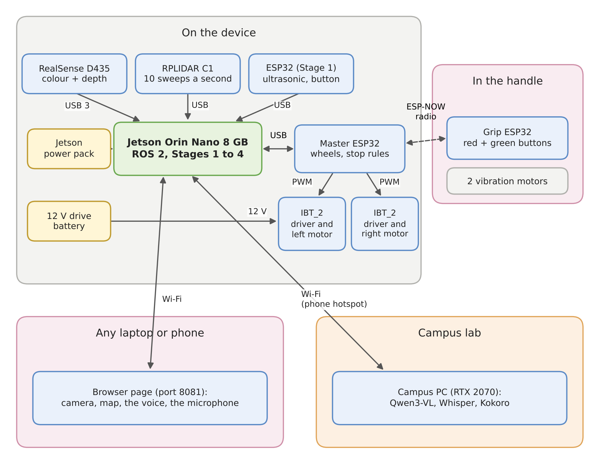

*Figure 1. Hardware Connections of the Finished Device*

Figure 2 to Figure 5 show the finished device. The base carries the 12 V battery, the Jetson, the master ESP32 on its breadboard, the two motor drivers and the forward ultrasonic sensor, between the two driven wheels. A steel pole rises from the base to the handle. The depth camera sits on a ball mount on top of the handle, where it can be tilted, and the LiDAR hangs upside down under the handle's plate. The red talk button and the green stop button are at the two ends of the handle, under the user's thumbs.

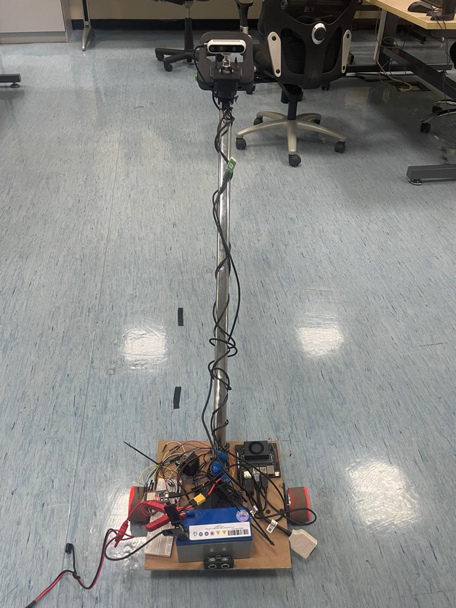

*Figure 2. The Finished Device*

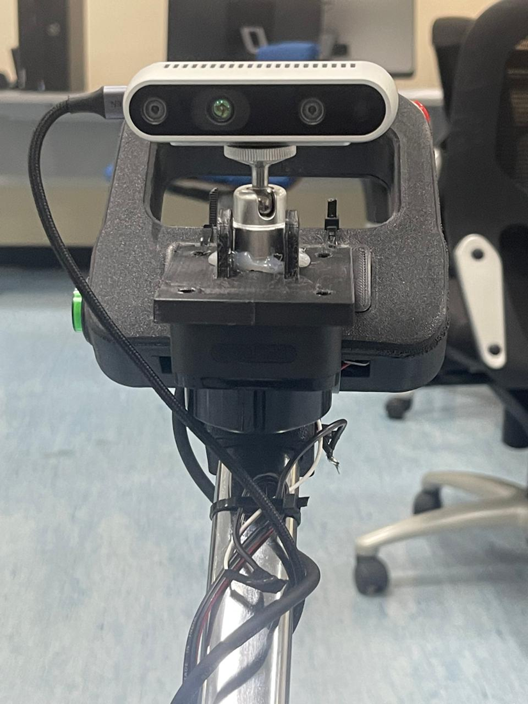

*Figure 3. The Top of the Pole: the Depth Camera on Its Ball Mount and the LiDAR Below the Handle*

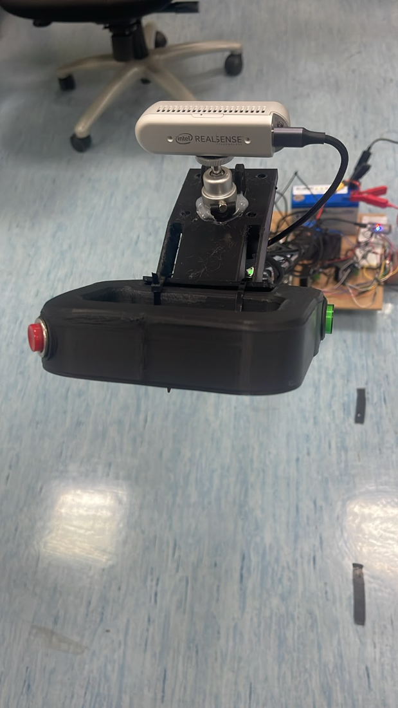

*Figure 4. The Handle With the Red Talk Button and the Green Stop Button*

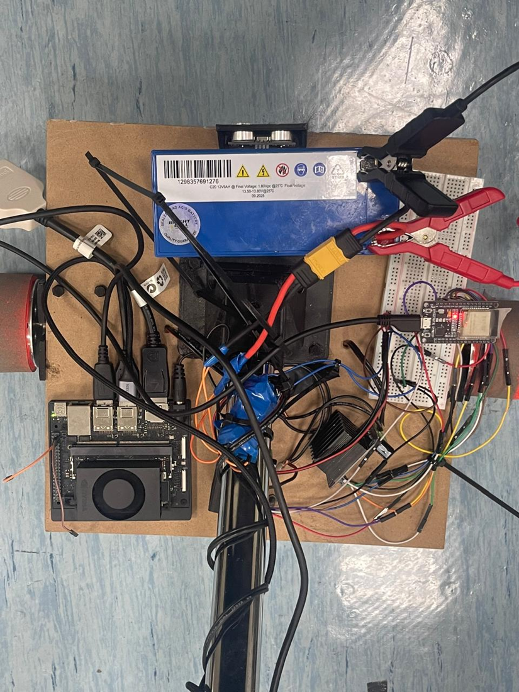

*Figure 5. The Base From Above: Battery, Jetson, Master ESP32, Motor Driver and Ultrasonic Sensor*

### Circuit Diagrams

The team wired two circuits by hand. The first is the Stage 1 ESP32 with the ultrasonic sensor and the first talk button (Figure 6). The ESP32 takes 5 V and data from the Jetson through one USB cable, and passes 5 V on to the HC-SR04. The sensor's echo pin also swings to 5 V, but the ESP32 pins accept only 3.3 V, so the echo goes through a divider made of a 1 kOhm resistor in series and a 2 kOhm resistor to ground. That gives 5 x 2 / (1 + 2) = 3.3 V at GPIO 18. The trigger needs no change, because 3.3 V is enough for the sensor to read a high level.

The button sits between GPIO 23 and ground with no resistor. The firmware switches on the ESP32's own pull-up resistor, so the pin reads high when the button is free and low when it is pressed.

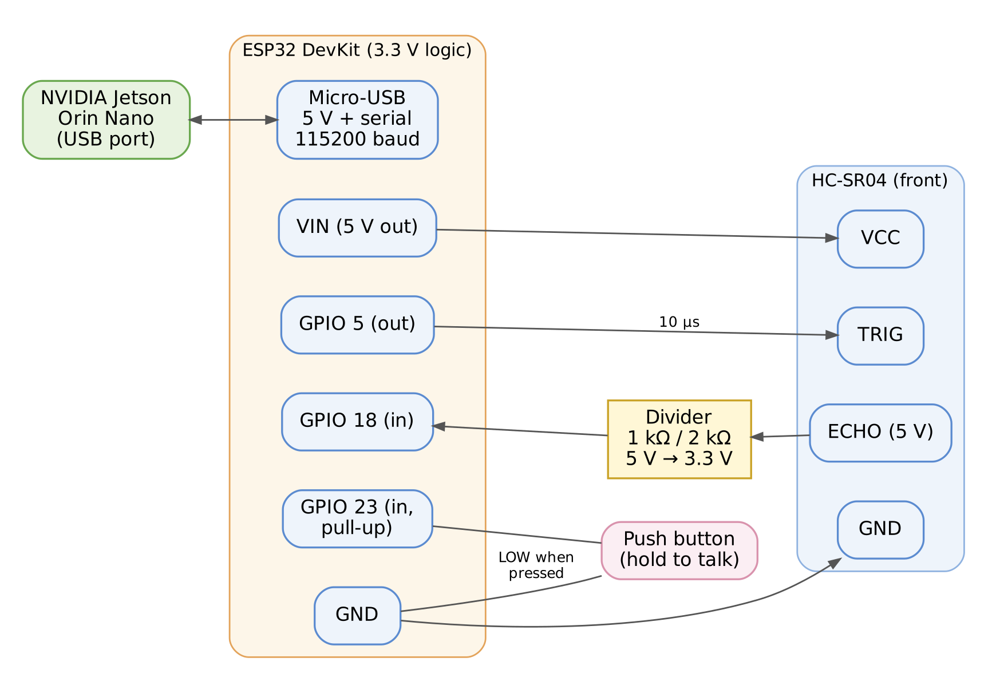

*Figure 6. ESP32 Wiring for the Ultrasonic Sensor and the Talk Button*

The second circuit is the drive (Figure 7). Each IBT_2 board has two control inputs, one for forward and one for backward. The master ESP32 sends each a PWM signal (pulse-width modulation: the pin switches on and off very fast, and the share of time it is on sets how hard the motor pushes). Two more pins per board switch the board on. The board's small logic side runs from the ESP32's 3.3 V pin, and the 12 V battery feeds only the motor side. The battery's minus must also be joined to the ESP32's ground, or the control signals have nothing to be measured against. The first wiring check on 11 November found exactly that fault: the left driver worked on and off until the ground was fixed. That check reads every motor pin with the 12 V unplugged, so a wiring fault shows up before a wheel can move.

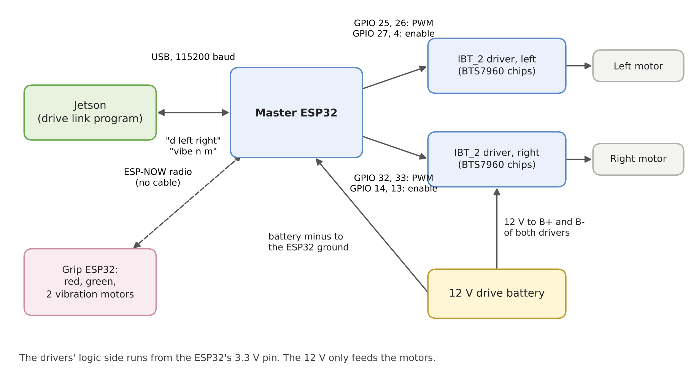

*Figure 7. Wiring of the Drive: Master ESP32, Motor Drivers, Battery and the Radio Link to the Grip*

The grip was built by a teammate as a closed unit. Its red button is on pin D32 and its green button on D33, each to ground. Each vibration motor is driven by three pins together, because one ESP32 pin cannot give the current a motor needs. A third sensor is designed but not wired: a second HC-SR04 on the base, facing back at the user, read by the master through the same 1 kOhm and 2 kOhm divider. It would stop the wheels when nobody is within about 1 m behind the device.

### Timing Diagrams

Figure 8 shows the timing on the ESP32. Every 100 ms the firmware sends a 10 microsecond pulse on the trigger pin. The sensor answers with an echo pulse whose length is the time the sound takes to reach the object and come back. For an object 1.0 m away that is 2 x 1.0 / 343 = 5.83 ms. The distance is half the echo time multiplied by the speed of sound. The firmware gives up after 25 ms, which matches about 4 m, and then sends "-1" for "nothing in range". The result goes out as one line of text, such as "1.00", at 115200 baud; six characters take about half a millisecond. The button is read on every loop. A change is only believed once the pin has stayed the same for 30 ms, which hides the bouncing of the contact, and then a line "B1" (pressed) or "B0" (let go) is sent. The Stage 1 reader skips any line that is not a number, so both kinds of line share one cable.

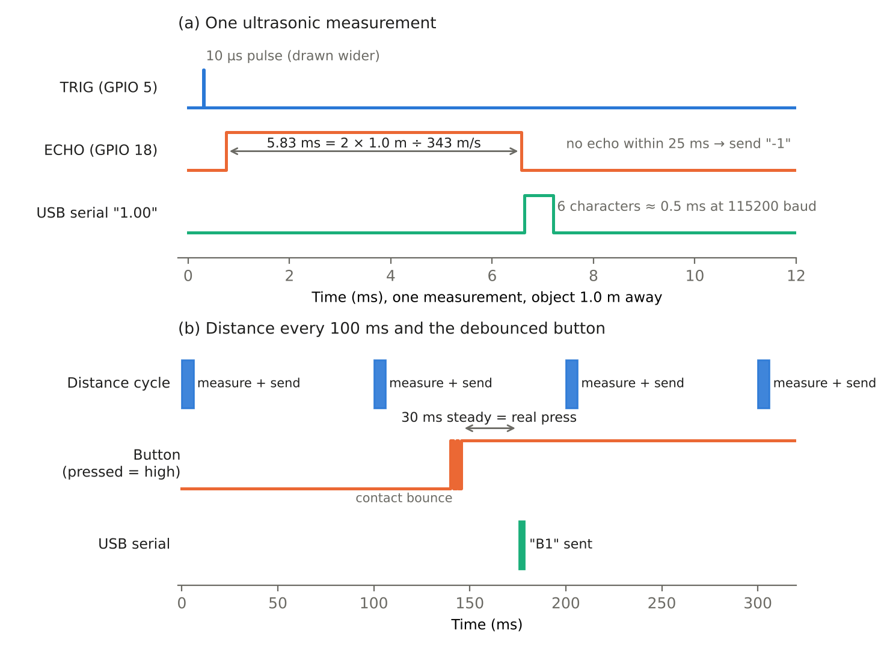

*Figure 8. ESP32 Timing: One Ultrasonic Measurement and the Debounced Button*

Figure 9 shows the timing of one spoken question that needs a spoken answer, measured on 31 October with the Kokoro voice on the PC's graphics card. From the moment the button is let go, the answer was ready to play after 3.8 s on average. Speech to text takes about 0.08 s and the voice about 0.3 to 0.5 s. The two calls to Qwen take most of the rest. About 1 s on the Jetson side is not yet explained and is logged as open work. Stage 1 runs alongside all of this at its own fixed rate of ten levels a second and never waits for Stage 2.

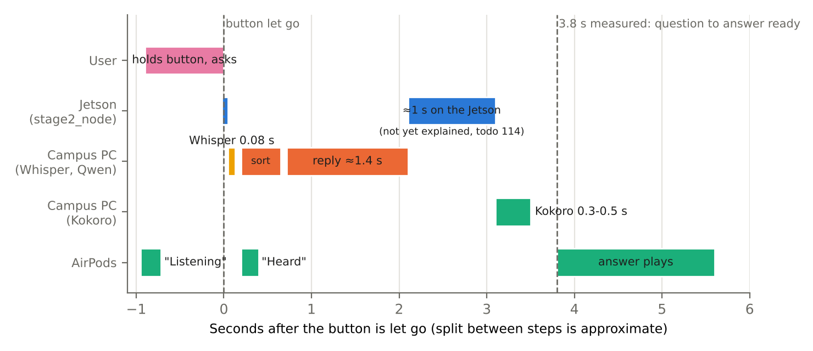

*Figure 9. Timeline of One Spoken Question and Its Spoken Answer*

The drive has its own timing, and safety depends on it. Ten times a second the Jetson sends the master one line with the power for each wheel, and one with the vibration strength. The master keeps a wheel turning only while those lines keep coming: if it hears nothing from the Jetson for 0.5 s, it stops both wheels by itself. Every 50 ms the master sends the grip a small radio packet and the grip answers with its buttons. If the grip is silent for 0.3 s, the master stops the wheels too. A vibration lasts 0.5 s unless the Jetson repeats it. These limits are short on purpose. A frozen program, a pulled cable or a flat grip battery all end the same way, with the wheels stopped in under half a second.

### Analysis of Performance

The hardware was measured on its own before the software was judged. The main results are below; [results.md](results.md) gives the full numbers.

**Sensors.**

The LiDAR runs at 10.01 sweeps a second. Against a ruler, the LiDAR and the camera read a wall within 2.5 cm at 0.5 m and 1 m, and within 4.5 cm (LiDAR) and 7.9 cm (camera) at 2 m. The camera gives 30 pictures a second on its own. With everything running it first fell to 15 to 22, because two browser views kept drawing pictures with nobody watching. After both views were changed to work only while a page is open, it gave 28 to 29 pictures a second at rest and 20 to 24 while tracking an object.

**Jetson load.**

With Stages 1 to 3 running together for 10 minutes, the Jetson used 41% of its six processor cores on average (61% at peak), at most 2.6 of its 7.6 GB of memory, no swap, 7.4 W on average and 53 C at most. With the camera added to the map the figures rose to 47% and 3.0 GB. In every test Stage 1 kept its rate of ten levels a second. This is why the Raspberry Pi was not added.

**The drive.**

With the wheels in the air on 13 November, each wheel made 27.5 turns in 10 s at full power. With a wheel 74 mm across, that is 0.64 m/s. On the floor on 15 November the picture was different (Figure 10). Below 45% power the motors only hummed and the device stayed where it was. At 45%, 62% and 78% it moved at 0.06, 0.14 and 0.31 m/s, measured with the LiDAR. The drive program therefore does not treat power as a straight line of speed. It looks the power up in this measured table. A turn on the spot also came out short, 48 degrees for 86 asked, because the castor wheel drags sideways. A fixed factor of 1.8 on every turn brought it to 84 degrees.

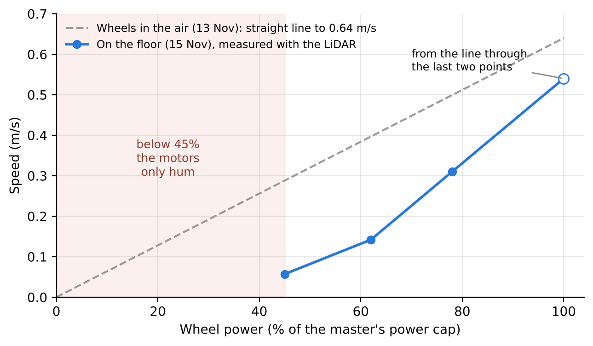

*Figure 10. Measured Speed Against Wheel Power: in the Air and on the Floor*

**Power and battery.**

The Jetson drew 7.4 to 8.8 W in the load tests. A power budget from the datasheets puts Stages 1 to 3 at about 20 W typical and 50 W at peak, including the sensors and a margin, and recommends a battery of at least 100 Wh for the 3-hour target (a 4-cell 14.4 V, 10 Ah pack of 144 Wh was suggested). The motors run from their own 12 V battery, so motor current never passes through the Jetson's supply. The 3-hour run has not been tested. The Jetson's own power is the weakest part of the hardware. It restarted by itself six times on 29 October and three more times on 15 November, at light load, which matches a loose plug or a power pack that cannot hold its voltage. Section 6.5 comes back to this.

## Software Implementation

All on-device software is written in Python on ROS 2 Humble, the open-source robot middleware that passes messages between programs. Each stage is one ROS 2 package, four in all. Each package keeps its rules in plain Python files with no ROS inside, so the logic can be tested on any computer with made-up inputs, and keeps ROS in thin wrapper programs called nodes. The two ESP32 boards on the drive run programs written in C++ with the Arduino tools. The code follows PEP 8, uses SI units and the standard ROS axes, and names its coordinate frames the ROS way (map, odom, base_link).

### Entities

Figure 11 shows where every program runs, and Table 3 lists them. Five processors share the work. The three ESP32 boards each run one small firmware program: one reads the ultrasonic sensor, one runs the wheels, and one sits in the handle. The Jetson runs the four ROS 2 packages, one per stage. The campus PC runs three network servers that do the heavy AI work: Ollama serving the Qwen3-VL-4B vision-language model (a model that answers questions about a picture), a speech-to-text server built on faster-whisper, an optimised version of OpenAI's Whisper, and a voice server built on Kokoro, a small text-to-speech model. A sixth computer, the laptop or phone with the web page open, runs no APNVI program of its own. Its browser plays and records sound.

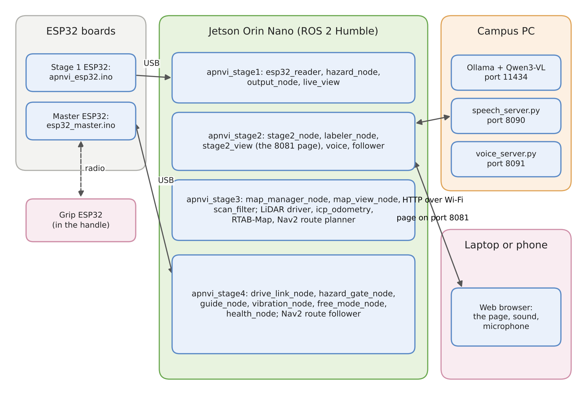

*Figure 11. Software Deployment Across the ESP32 Boards, the Jetson, the Campus PC and the Browser*

| **Program** | **Runs on** | **Job** | **Lines of code** |
|------------------|-----------|--------------------------------|------------|
| apnvi_esp32.ino | Stage 1 ESP32 | Ultrasonic distance ten times a second; button lines B1 and B0 | 81 |
| esp32_master.ino | Master ESP32 | Wheel power for both drivers; the five stop rules; radio link to the grip; vibration | 483 |
| esp32_reader | Jetson | Reads the Stage 1 ESP32's lines; publishes the distance and the button | 127 |
| hazard_node + hazard_check | Jetson | Nearest distance in a 70 cm path, danger level, blocked camera, side warning, the low-obstacle sweep for the route planners | 788 |
| output_node | Jetson | Beeps and the on-screen bar (beeps off by default since 26 Oct) | 252 |
| live_view | Jetson | Stage 1 depth view in a browser, port 8080, only while watched | 222 |
| stage2_node + asking, finder, speech | Jetson | Hold-to-talk questions, sorting, boxes and sentences, map commands by voice, pinning found things | 1 468 |
| locate + eye | Jetson | A found thing's point on the map from its box and the depth picture | 247 |
| labeler_node + labels | Jetson | The map labels itself: asks Qwen for signs and landmarks, pins them | 377 |
| follower | Jetson | Keeps the red box on the object between AI answers (CSRT tracker) | 419 |
| voice | Jetson | Says sentences with Stage 1 always first; sends the sound to the browser | 275 |
| stage2_view | Jetson | The 8081 page: camera, red box, Stage 1 strip, map, buttons, sound and microphone | 874 |
| map_manager_node + map_names + relocalizer | Jetson | Saves and loads maps by name; finds the device on a saved map; owns /map and the pins | 1 152 |
| map_view_node + map_picture, scan_filter | Jetson | Draws the map with the device and the pins; drops the user and the handle from the LiDAR sweep | 398 |
| drive_link_node + drive | Jetson | The only program that talks to the master: speed to wheel power, the master's reports | 714 |
| hazard_gate_node, vibration_node + rules | Jetson | Forward speed to zero when something is too close; the grip's vibration signals | 562 |
| guide_node + guide, places | Jetson | Destinations, pause and continue, arrival, why it is waiting | 734 |
| free_mode_node + free_mode | Jetson | Free mode steering: turns only, and only while pushed | 434 |
| health_node + health | Jetson | Says "Ready"; speaks when a part stops working and when it is back | 201 |
| sllidar_node, icp_odometry, rtabmap, planner_server, controller_server | Jetson | Existing ROS 2 packages: LiDAR driver, LiDAR odometry, RTAB-Map, Nav2's route planner and route follower | Configured in launch files |
| speech_server.py | Campus PC | WAV in, words out (faster-whisper "base", graphics card), port 8090 | 135 |
| voice_server.py | Campus PC | Sentence in, WAV out (Kokoro, voice af_bella, graphics card), port 8091 | 235 |
| Ollama + qwen3-vl:4b-instruct | Campus PC | Picture and question in, box or sentence out, port 11434 | Configured |

*Table 3. Software Entities and Where They Run*

### Functions

This section explains the main functions of each stage, and then the functions that join the stages into one product. 

**Stage 1: the real-size path and the side warning.**

During the build the team changed what counts as "in the way". The first design looked at a fixed box in the middle of the picture, which is only about 25 cm wide close up. The built version turns every depth pixel into a real position, using the camera's lens numbers and its height above the floor, and keeps only the pixels inside a path 70 cm wide (shoulders plus a margin), from 10 cm to 2 m above the floor. The nearest distance is the 5th percentile of those pixels, so a few noisy pixels cannot trigger a warning. The level then follows the thresholds from the original design: stop at 0.5 m or less, warning at 1.5 m, notice at 2 m. A level only becomes safer once the distance is 10 cm past the boundary, so it does not flicker.

The build also added a warning for something closing in from the side, such as a person about to cross the path (Figure 12). The hard part is telling "something is moving" apart from "we are moving". The program squashes each depth picture into a top-down outline, like a laser scan, and lines it up with an outline from 0.15 to 0.5 s earlier using the iterative closest point (ICP) method, which finds the turn and shift that best fit one set of points onto the other. Once the camera's own movement is removed, columns where something now stands at least 15 cm nearer than before belong to a moving object. If that object is closing in at 0.3 to 2.5 m/s and would enter the path within 1.5 s, three pictures in a row, the node publishes "left" or "right".

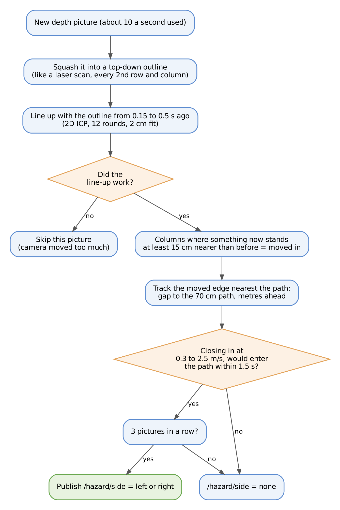

*Figure 12. Side-Approach Warning: Separating a Moving Object from the Moving Camera*

**Stage 2: find or answer.**

Figure 13 shows how one question is handled. While the button is held, the microphone records. When it is let go, the recording goes to the speech server, and the user hears "Heard" as soon as the words come back. Qwen then sorts the question, from the text only: "where is a water bottle" is FIND, while "what is the nearest sign" or "read the sign" is ANSWER. For FIND, Qwen gets the newest colour picture and returns a box on a 0 to 1000 scale, which the program turns into pixels and draws in red. For ANSWER, Qwen writes one short sentence, at most 200 characters, with a box on what it is about if there is one. If no words were heard, the user hears "I didn't catch that. Hold the button and ask again". If the PC cannot be reached, the user hears "I can't reach the helper computer". If nothing comes back, the user hears "Still thinking" at about 4 s and 10 s and "Sorry, that took too long" at 30 s.

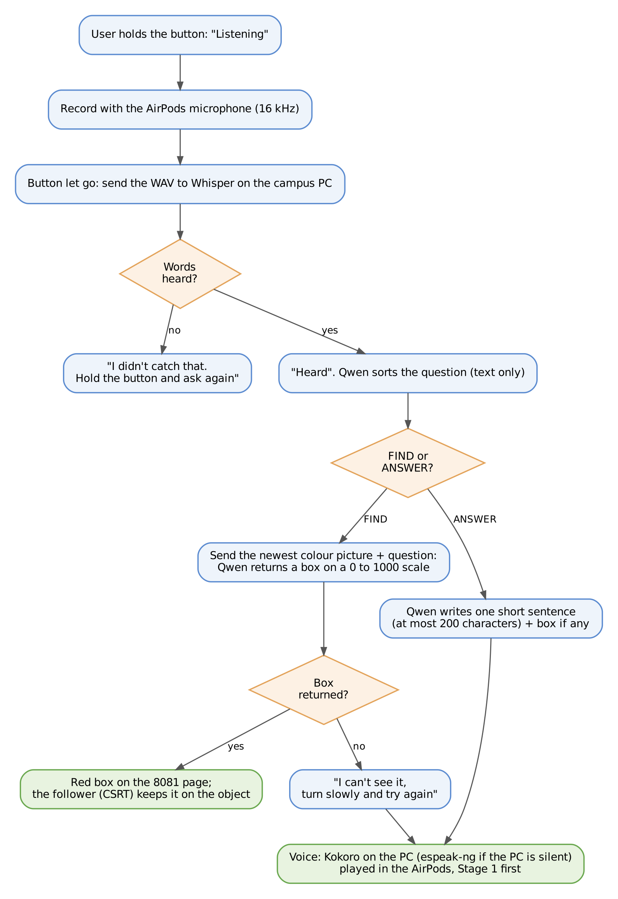

*Figure 13. Handling of One Spoken Question in Stage 2*

Qwen answers about every 1.5 to 2 s, and each answer is about a picture that is already old when it arrives. On its own the red box would jump every 2 s and always lag behind the object. The follower solves this with the usual "detect now and then, track in between" design. It keeps the last 8 s of small camera pictures. When an answer arrives, it starts an OpenCV CSRT tracker on the picture the answer was about, runs it forward to catch up to now, and then moves the box on every new picture. CSRT replaced the faster KCF tracker after a test: on a turning, fast object CSRT stayed on it 100% of the time against 2 to 4% for KCF, at 17 to 20 ms a picture on the Jetson.

**Stage 2: the voice, with Stage 1 always first.**

Spoken answers must never hide a safety warning. The voice program therefore listens to the Stage 1 level before it speaks (Figure 14). At clear or notice it speaks at full volume, at warning it speaks more quietly, and at stop it cuts the sentence off and holds it. If the danger clears within 10 s the sentence is said again; otherwise the user hears "Please ask again". The voice itself comes from Kokoro on the campus PC. Fixed phrases such as "Listening" and "Heard" are made once at start-up and only played after that, so they never wait on the network. If the PC does not answer within 3 s, the robot voice espeak-ng on the Jetson says the sentence instead, and the PC is left alone for 30 s.

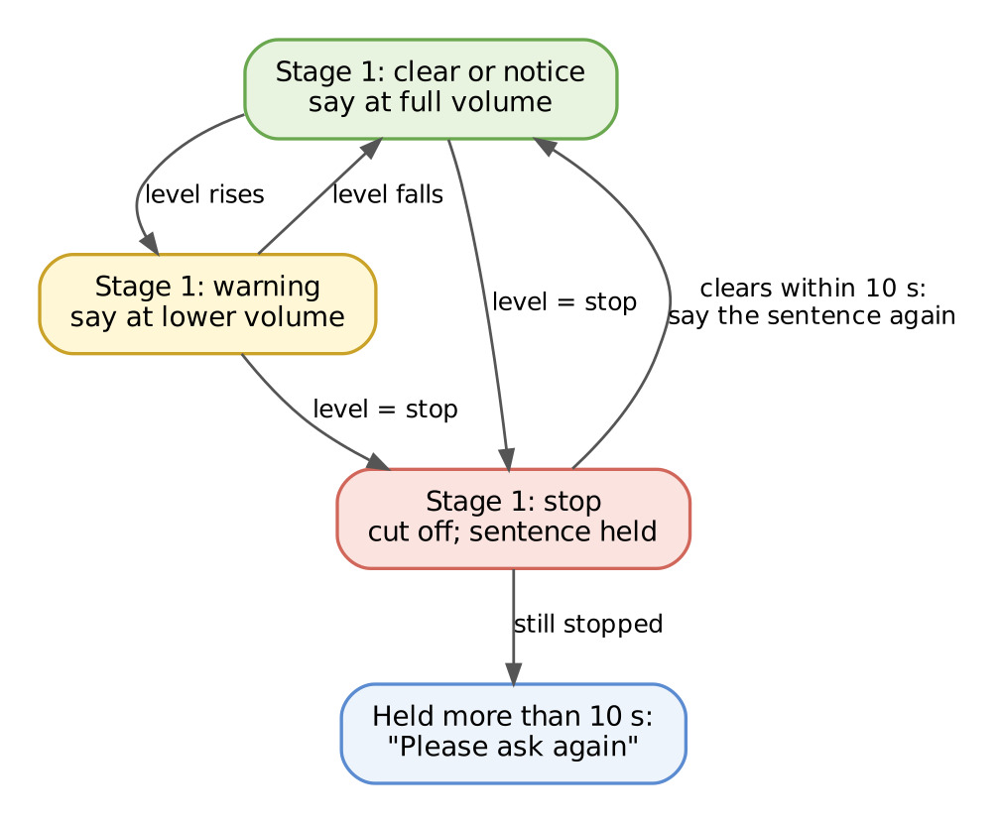

*Figure 14. Voice Priority: How the Stage 1 Level Controls Stage 2 Speech*

**Stage 3: map, save, load and find itself.**

Figure 15 shows the Stage 3 pipeline. The LiDAR driver publishes ten sweeps a second. The odometry node lines up each sweep with the last one (ICP again) to work out how far the device moved and turned, because the device has no wheel counters yet. RTAB-Map (Real-Time Appearance-Based Mapping) keeps a graph of the places the device has been, closes the loop when it comes back to a known place, and draws a grid of 5 cm squares. Since 31 October the camera's colour and depth can be added so that RTAB-Map can also recognise places by sight. Nav2, the standard ROS 2 navigation stack, plans a route on the grid.

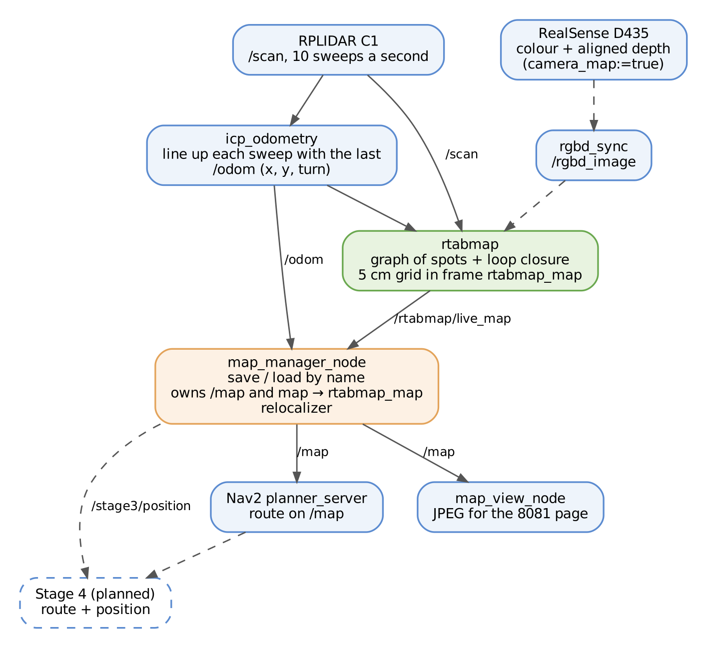

*Figure 15. Stage 3 Mapping, Localization and Route Planning Pipeline*

The team wrote the map manager because RTAB-Map's own way of finding the device on a loaded map did not work: after a load, the position stayed at the map's start point. The map manager now owns the map that every other program uses. While mapping, it passes RTAB-Map's grid on unchanged. After a load, it shows the clean saved map and shifts RTAB-Map's frame so that the LiDAR sweep fits the saved walls. The search that finds the shift is the relocalizer (Figure 16). It turns the saved map into a "distance to the nearest wall" picture, tries the sweep at every free spot every 20 cm and every 5 degrees, and scores how many of 120 sweep points land within 10 cm of a wall. The six best answers are refined in steps of 3 cm and 1 degree. An answer is used only when it fits at least 75% and beats the best answer elsewhere by 0.08. Maps are saved under spoken names. "ESB117" is stored as esb117.db (the RTAB-Map map) and esb117.json (a table of named places and signs), and the saved file is never changed while a copy is in use.

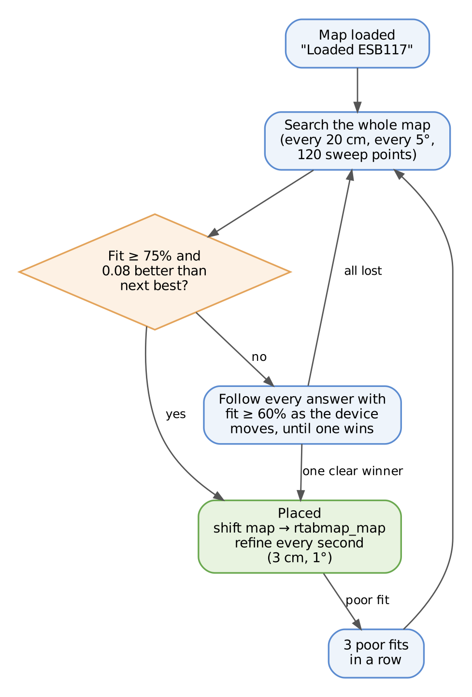

*Figure 16. How the Map Manager Finds the Device on a Saved Map*

Two more changes came from putting the LiDAR on the real device. It now sits 77 cm up with the handle, the pole and the user's body about 5 cm behind it, and they move with it. A small filter drops every point closer than 0.7 m in the 120 degrees behind the device, and keeps the front and the sides at every distance. The LiDAR is also mounted upside down, which mirrors its sweep. Until the map manager was told, it placed the device 3.5 m away and facing backwards on a loaded map.

**Stage 4: from a route to wheel power.**

Stage 4 turns the route into movement, and three programs sit between the route and the wheels (Figure 17). Nav2's route follower uses Regulated Pure Pursuit: it aims at a point a short way along the route, and slows down in turns and near obstacles. Ten times a second it gives a forward speed and a turn rate. The hazard gate passes them on, but sets the forward speed to zero while anything is 0.5 m or closer to the front of the device, while Stage 1 says stop, or when Stage 1 has been silent for half a second. Stage 1 measures from the camera, which sits 0.83 m behind the front edge of the base, so the gate takes that distance off first. The drive link turns the speed and the turn rate into a power for each wheel, through the measured floor table (Figure 7), and sends them to the master ESP32 over USB. It is the only program that talks to the master. The master makes the last decision itself. It stops both wheels when the red button is pressed, when the green button is on, when the grip's radio is silent, or when the Jetson is silent, whatever the last command said.

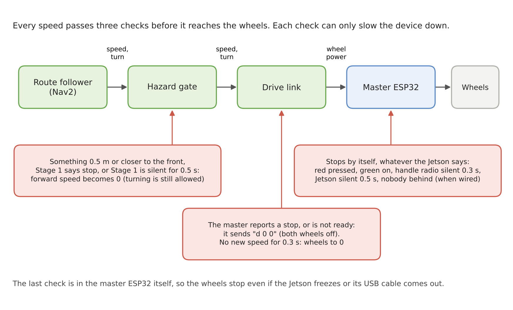

*Figure 17. The Three Checks Between a Route and the Wheels*

After the green button the wheels stay stopped until green is off and the speed asked for has been zero once, so a command that is still arriving cannot start them again. The master can also come up stuck after a power cut, when it answers nothing readable. The drive link notices when its first question goes unanswered for 5 s and restarts the master through the USB cable, up to three times.

**Stage 4: the guide.**

The guide decides where to go and when to stop. It has three states: idle (no trip), guiding and paused. A destination starts a trip and the user hears "Taking you to" and the name. The route is planned again every second, so it bends when someone steps in. Pressing red on the way stops the wheels at once and pauses the trip. What the user says next decides what happens: "continue" carries on, a new destination replaces the old one, and any other question drops the trip. Green stops the wheels and pauses in the same way. Within 0.5 m of the goal the guide stops and says "You have arrived".

Silence while standing still is the worst answer for a blind user. After 4 s of being blocked the guide says "Something is in the way. Waiting", and after 6 s without a route it says "I can't find a way there right now". In the second case it also wipes the obstacle marks the route planners have collected. The camera's marks stay until the camera sees that piece of floor empty again, so a box that was seen close up and then taken away could otherwise block a route for good. The walls come back from the saved map within a second.

**Things on the map: "take me to the water bottle".**

Until 16 November Stage 2 could only draw a box round a thing in the camera picture. It did not know where the thing was in the room, so the guide could not go to it. The link between the two is one small calculation (Figure 18). The box from Qwen is on the colour picture. The depth picture comes from another lens with a wider view, so the box is first moved across by angle. Inside the middle of the box the program sorts the depth readings and takes one about a third of the way up, because a thing fills most of its box and whatever shows through behind it is further away. The distance and the box's place in the picture give "so far ahead and so far to the left". The camera sits 0.70 m behind the centre of the wheels, and the map manager knows where the device stands and which way it faces, so the point can be written on the map. A thing further than 5 m away, or with no depth reading because it is too close, shiny or very small, is not placed, and the user is told why.

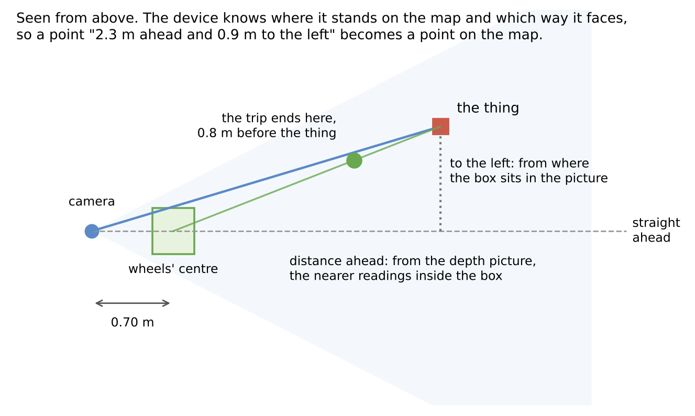

*Figure 18. Placing a Found Thing on the Map, Seen From Above*

Each placed thing becomes a pin: a name and a point, kept in a small table next to the saved map. Figure 19 shows a whole trip. The guide first looks the name up among the saved places, the signs and the things. Names are compared loosely, because people do not repeat themselves word for word: "bottle" matches "water bottle", "ESB 117" matches "ESB117", and "bin" matches "trash can". If two chairs are on the map, the nearer one wins. If the name is not on the map, Stage 2 looks for it in the camera picture at that moment. A thing usually sits on a desk or against a wall, where no route can end, so the trip ends 0.8 m in front of it, on the line it was seen from. On arrival the device says where the thing is, for example "The water bottle is ahead of you, about 1 metre". The user can also pin the spot they are standing on by saying "save this place as my desk".

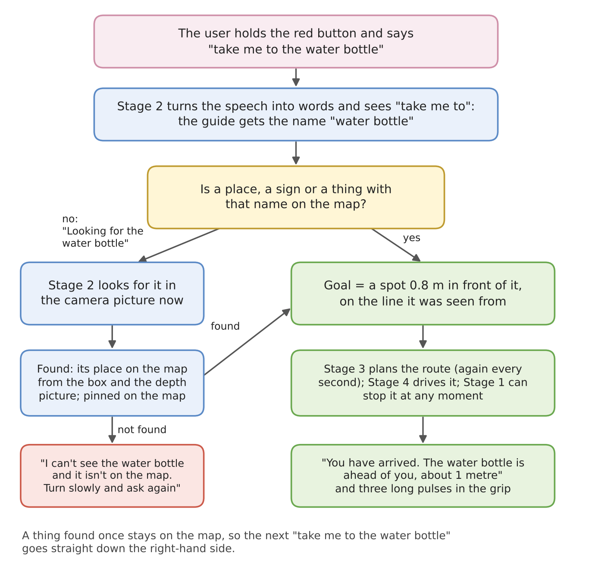

*Figure 19. Handling of "Take Me to the Water Bottle" Across the Four Stages*

**The map labels itself.**

A map of bare walls is of little use to someone who asks for "the door". The labeller fills the map in by itself (Figure 20). Each time the device has moved half a metre or turned 20 degrees, it sends the newest camera picture to Qwen and asks for the signs it can read and the fixed things it can see, such as doors, whiteboards, desks and bins. The answer is cleaned: people, walls, the floor and the ceiling are dropped, and so are boxes that are tiny or fill the picture. Each thing that is left is placed on the map with the calculation above and pinned. One look can be wrong, so a pin is only shown, and can only be a destination, once the same name has been seen twice within a metre. A sign that reads like a room ("ESB117", "Lab 2") is marked as a room. The pins are saved with the map and come back when the map is loaded, so "take me to the door" works at once on the next visit.

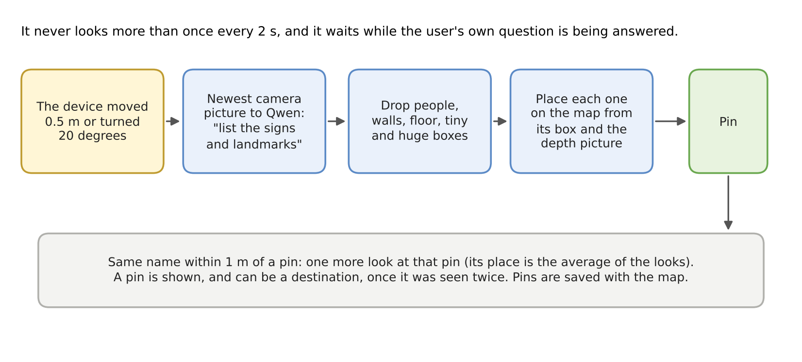

*Figure 20. How the Map Labels Itself*

The labeller is kept out of the way of everything more urgent. It never looks more than once every two seconds. It waits while the user's own question is being answered. It receives camera pictures only for the moment of a look, because every full-size picture a Python program receives costs the Jetson time even when the picture is thrown away. The user can also say "scan the room" and turn slowly on the spot. The labeller then looks every two seconds for a minute and says how many new things it found.

**Sound through the browser.**

The AirPods made the Jetson's Wi-Fi unusable, and the device has no speaker. On 15 November the team decided to send the sound through the device's own web page instead (Figure 21). Any laptop or phone that has the page open becomes the device's mouth and ears. When the device speaks, the page plays the sentence. While the red button is held, the page records with that computer's microphone and sends the recording to the Jetson, where it is handled the way a recording always was. Browsers give a page the microphone only when the page is opened from the same computer or over an encrypted link, so the laptop opens the page through a forwarded port.

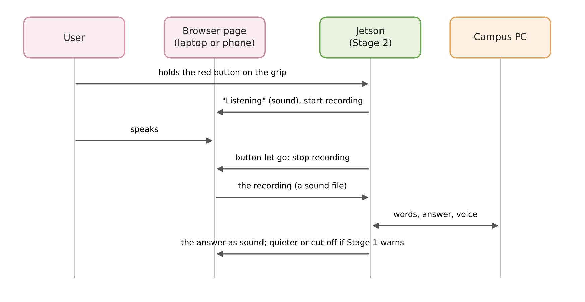

*Figure 21. One Spoken Question With the Sound Going Through the Browser Page*

The rule "Stage 1 first" still holds: a sentence is played more quietly at warning and cut off at stop. One thing changed. The device's own sentences, such as "You have arrived" and "Something is in the way", are now said at once at any level. They are often about the very thing that put Stage 1 at stop, and under the old rule they were held back and then replaced by "Please ask again".

**Free mode: the user pushes, the device steers.**

With no trip on, the user pushes the device like a walker. The first version of free mode only warns: the grip gives its "near" and "stopped" signals while the device is being pushed and for 3 s after it slows down, so the signal does not stop just as the user reaches the obstacle. The second version also steers (Figure 22). The rule that makes it safe is that in free mode the device never drives forward. It only turns, with the two wheels at equal and opposite power, so all forward movement comes from the user. The program looks at a lane in front of the device, 1.5 m long and 0.9 m wide, using the LiDAR sweep and the camera's low obstacles together. If the lane is blocked, it tries headings of 10, 20 and so on up to 60 degrees to each side, and turns toward the smallest one whose lane is clear. It turns only while the LiDAR's own tracking shows the device moving forward at 0.15 m/s or more, which means someone is pushing. If the user lets go, the forward movement stops, the test fails, and the turning stops with it. A turn also ends after 60 degrees or 3 s. Steering stayed switched off until it passed the floor tests of Section 6.3 on 17 November. It is now on.

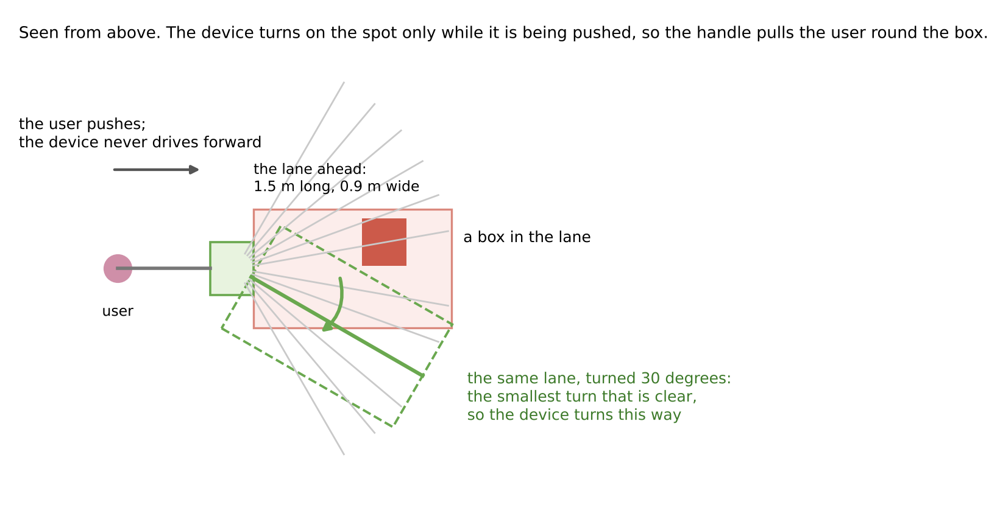

*Figure 22. Free Mode Steering: the Lane Ahead and the Smallest Clear Heading*

**Health: saying when something is wrong.**

A blind user cannot read a status page. A small program watches the parts of the device: the obstacle warning, the camera, the LiDAR, the wheels, the handle and the place on the map. When one stops working it says so once, in plain words such as "The camera is covered or not working", and says so again when the part is back. It also says "Ready" when the device has started. A part is only watched after it has been seen working once, so a part that is switched off on purpose in a test does not nag.

### Interfaces

The programs talk through ROS 2 topics on the Jetson, HTTP requests to the campus PC, and serial lines from the ESP32 boards. ROS 2 topics use the Data Distribution Service (DDS) underneath. Only standard ROS 2 message types are used, so no custom message package is needed. Table 4 lists the main topics the team's own programs use, and Table 5 lists the network and serial services.

| **Topic**                      | **Type**            | **From -\> to**                                      | **Rate or meaning**                              |
|-------------------|--------------|----------------------|------------------|
| /ultrasonic/distance           | Float32             | esp32_reader -\> hazard_node                         | 10 a second, metres, -1 = nothing                |
| /button/pressed                | Bool                | esp32_reader or the page -\> stage2_node             | True = held down                                 |
| /hazard/level                  | String              | hazard_node -\> output_node, stage2_node, page       | clear, notice, warning, stop; 10 a second        |
| /hazard/distance               | Float32             | hazard_node -\> output_node, page                    | Nearest distance in metres                       |
| /sensor/status                 | String              | hazard_node -\> output_node, page                    | camera_ok or camera_blocked                      |
| /hazard/side                   | String              | hazard_node -\> page                                 | left, right or none                              |
| /target/result                 | String (JSON)       | stage2_node -\> page                                 | Found or not, label, box, sentence               |
| /scan, /odom                   | LaserScan, Odometry | LiDAR driver, icp_odometry -\> RTAB-Map, map manager | 10 a second                                      |
| /map                           | OccupancyGrid       | map_manager_node -\> Nav2, map_view_node             | Live grid, or the saved map after a load         |
| /stage3/command, /stage3/reply | String              | page -\> map manager -\> user                        | save_map, load_map, new_map; short sentence back |
| /stage3/position | PoseStamped | map_manager_node -\> guide, Stage 2, labeller               | 5 a second                                       |
| /stage3/map_image              | CompressedImage     | map_view_node -\> page                               | Only while a browser is open                     |

| /stage3/pins | String (JSON) | map_manager_node -\> page, Stage 2, labeller | The named places, signs and things of the running map |
| /stage2/request | String (JSON) | stage2_node -\> guide_node | After each question: take me to, follow-up, or other |
| /stage2/locate, /stage2/located | String (JSON) | guide_node \<-\> stage2_node | "Find this thing now"; a map point back, or why not |
| /camera/obstacle_scan | LaserScan | hazard_node -\> route planners, free mode | What the camera sees low down, as a sweep; 10 a second |
| /cmd_vel_nav, /cmd_vel_free | Twist | route follower, free mode -\> hazard gate | Forward speed and turn rate asked for |
| /stage4/cmd_vel | Twist | hazard gate -\> drive link | The same, after the hazard check |
| /stage4/guide_state | String (JSON) | guide_node -\> page, vibration, free mode | idle, guiding or paused; the goal; metres left |
| /stage4/vibration, /stage4/vibration_motor | UInt8 | vibration_node -\> drive link | Strength 0 to 100, and which grip motor; 10 a second |
| /grip/red, /grip/green | Bool | drive link -\> guide, Stage 2 | The handle's two buttons |
| /voice/say | String | guide, map manager, labeller, health -\> stage2_node | A sentence the device must say |
| /voice/out, /voice/recording | String | stage2_node \<-\> page | Sound for the browser to play; the browser's recording |

*Table 4. Main ROS 2 Topics Between the Programs*

| **Service**                     | **Port** | **Request**                                         | **Reply**                       |
|--------------------|---------|----------------------|----------------------|
| Ollama, Qwen3-VL-4B (campus PC) | 11434    | Question, plus a JPEG picture for FIND and ANSWER   | Box list or one sentence (JSON) |
| Speech to text (campus PC)      | 8090     | POST /transcribe with a WAV file                    | {"text": ..., "seconds": ...}   |
| Voice (campus PC)               | 8091     | POST /speak with a sentence                         | WAV file, 24 kHz                |
| The device's page (Jetson) | 8081 | Browser: page, pictures, Ask, Listening mode, Track, sound and microphone | Live page                       |
| Stage 1 depth view (Jetson)     | 8080     | Browser                                             | Live depth picture              |
| ESP32 serial (USB)              | \-       | 115200 baud, one line per message                   | "1.23", "-1", "B1", "B0"        |

| Master ESP32 serial (USB) | \- | 115200 baud: "d left right" (wheel power, -100 to 100), "vibe strength motor", "who" | "who master", "stop red", "clear red", "ready", button lines |
| Grip radio (ESP-NOW) | \- | A 10-byte packet every 50 ms: which vibration motor, how strong | The two buttons |

*Table 5. Network Services Used by the Device*

### Algorithm Analysis

Table 6 gives the cost of the main algorithms and the time they take on the hardware. The Stage 1 check is linear in the number of pixels, and the camera's 848 x 480 depth picture is about 400 000 pixels. It uses whole-array numpy operations, so the Jetson finishes it well inside the 100 ms between levels. The ICP step in the side warning works on every second row and column and stops after 12 rounds, so its cost has a fixed upper limit. The relocalizer is the most expensive search the team wrote. A coarse search tries every free spot every 20 cm and 72 turns, with 120 sweep points each; for a room of 10 x 10 m that is about 2 500 spots x 72 turns x 120 points, or about 22 million look-ups. The distance-to-wall picture turns each look-up into reading one number, and it runs only when the device is not yet placed. On the lab map it placed the device 4 s after the map was loaded. Nav2 found an 82-point route in 0.023 s.

| **Algorithm**         | **Work per run**                                                     | **Measured time**                                             | **Runs**                                               |
|-------------------|----------------------|----------------|----------------|
| Stage 1 hazard check  | One pass over about 400 000 depth pixels: O(pixels)                  | Well under 100 ms (10 levels a second held)                   | 10 a second                                            |
| Side warning (2D ICP) | 12 rounds x outline points x 17 neighbours, every 2nd row and column | Inside the same 100 ms                                        | 10 a second                                            |
| CSRT follower         | Correlation filter on a 480-pixel-wide copy                          | 17 to 20 ms a picture                                         | Every camera picture while tracking                    |
| Qwen3-VL-4B (PC)      | One model pass over picture and question                             | 0.5 s warm on the PC; 1.2 to 1.8 s round trip from the Jetson | Per question                                           |
| Whisper "base" (PC)   | One model pass over the recording                                    | 0.08 s on the graphics card                                   | Per question                                           |
| Kokoro voice (PC)     | One model pass per sentence; last 200 kept                           | 0.3 to 0.5 s; repeats instant                                 | Per sentence                                           |
| Relocalizer search    | Spots x 72 turns x 120 points, then refine 6 best                    | Placed 4 s after loading the lab map                          | Until placed; then a 3 cm, 1 degree refine each second |
| Nav2 route planning   | Grid search on the 5 cm map                                          | 0.023 s for an 82-point route                                 | Per destination                                        |

| Route follower (Regulated Pure Pursuit) | One look-ahead point on the route and the nearby obstacle map | Inside its 100 ms cycle | 10 a second while guiding |
| Placing a thing (locate) | One pass over the depth pixels in the middle of the box, then a sort | A few milliseconds; waits up to 1.5 s for a depth picture | Per found thing |
| Labeller look | One Qwen pass over the picture, then one placing per thing listed (at most 8) | Not timed alone; one Qwen pass takes about as long as a spoken answer (about 4 to 5 s in the lab) | At most every 2 s, only after moving |
| Free mode steering | 12 headings x the sweep points in view (about 500) | Well inside 100 ms | 10 a second while idle |
| Vibration and hazard rules | A handful of comparisons | Under 1 ms | 10 a second |

*Table 6. Cost and Measured Time of the Main Algorithms*

## Integration And Deployment

Each stage was first tested alone and then joined to the ones before it, one link at a time. One launch command now starts the whole device, Stages 1 to 4 (ros2 launch apnvi_stage4 apnvi.launch.py), and each stage can still be switched off for a test. A setup script, jetson_setup.sh, installs ROS 2, the camera and LiDAR drivers, RTAB-Map and Nav2, downloads the code from GitHub and builds the packages, so a new board can be set up in one step. This was used when the Jetson was replaced on 22 October.

For the lab the team wrote a small set of session tools. One script starts the device and prints its health, and one stops it. A third drives the device a set distance, sends a destination, types a question as if it were spoken, lists the pins on the map, plays one vibration signal, or records everything once a second to a log file. Settings that stay the same from run to run, such as the campus PC's address, the map to load and the camera's tilt, are read from one file on the Jetson at every start.

### Networking

The device needs a network link only for Stage 2. The first plan was to use the campus Wi-Fi. On 12 October the test failed: the Jetson on campus Wi-Fi could not reach the campus PC on the wired lab network. The university controls the PC's firewall and blocks every incoming connection, so the firewall rules the team added were ignored, and the Wi-Fi seems to be kept apart from the lab network. Tailscale, a private network tool, is also blocked at AUS. Running the AI on the Jetson itself was tested the same day. Qwen3-VL-2B took 6.3 s an answer (2.3 s at full clock speed), and with Stage 1 running every question timed out at 30 s. The team therefore kept the AI on the PC and joined both computers to a phone hotspot, with written approval from IT (Figure 23).

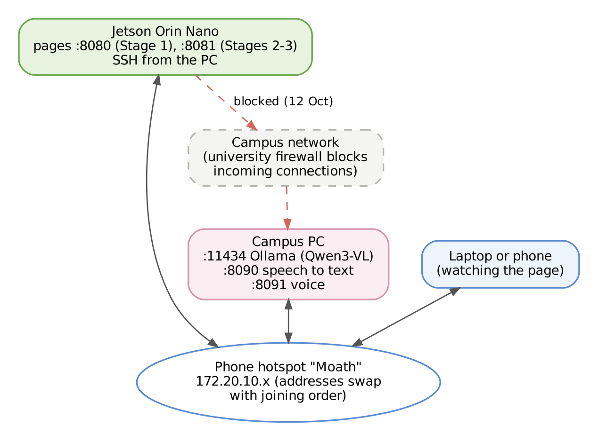

*Figure 23. Network Layout Used for Testing and the Demos*

This works, with three known problems. The hotspot gives out addresses in joining order, so the PC and the Jetson sometimes swap addresses and the address has to be checked before each run. Bluetooth earphones on the Jetson made its Wi-Fi unusable on 1 November (83 ms with lost packets, against 9 ms with the earphones off), most likely because Bluetooth and Wi-Fi share one radio on the Jetson. This is why sound now goes through the browser page and not through earphones on the device. And on the 5 GHz hotspot the Jetson lost 20% of packets on 29 October, most likely because of Wi-Fi power saving. In the other direction, the design holds up when the network fails. In a 37 s outage of the PC, Stage 1 stayed at 10.0 levels a second the whole time, the question got "I can't reach the helper computer" after 18.5 s, and answers worked again at once when the PC came back. Without the PC the device still warns about obstacles, vibrates, and can lead the user to any place already on its map. It cannot answer questions or find new things.

### Embedding

The device is meant to run with no screen or keyboard. Four steps make that possible. First, the browser pages draw pictures only while someone has them open; before this change one idle view used a whole processor core. Second, the programs run at different priorities, so that under load the safety layer is served first: Stage 1 at normal priority, the drive link and the hazard gate just below it, and everything else below that. Third, jetson_clocks runs at start-up to hold the clock speed, and the campus PC servers start by themselves when someone logs in. Fourth, an optional service starts the whole device when the Jetson has started, and the health program says "Ready" once it is up. Two problems still stand in the way of running fully on its own: the Jetson's sudden restarts, and reaching the Jetson after a restart before its Wi-Fi is up. For the 1 November half demo the team used a stopgap, with the earphones on the campus PC and a small relay there that spoke each answer. The browser page described in Section 5.2.2 replaced it.

**Development.**

Each ROS 2 package is self-contained with its own tests, and the firmware, AI server and console live beside them in one repository. The last parts, written on 15 and 16 November away from the lab, were first run against a stand-in for ROS with made-up sensors, and only then put on the device.

## User Interface Implementation

The finished device is used without sight, through two buttons on the handle, a voice and the grip's vibration. During development there is also a web page for the team, and that page now carries the sound. Table 7 lists what the user hears. The wording is kept short and plain.

| **When** | **What the user hears** |
|------------------------|------------------------------------------------|
| The device has started | "Ready" |
| Button pressed | "Listening" (on the way somewhere: "Stopping. Listening") |
| Words came back from speech to text | "Heard" |
| No answer yet at about 4 s and 10 s | "Still thinking" |
| FIND, thing found | Nothing (red box on the page); the thing is pinned on the map |
| FIND, thing not in view | "I can't see it, turn slowly and try again" |
| FIND, thing not in view but on the map | "I can't see it from here, but the door is on the map, about 4 metres away. Say take me to the door" |
| ANSWER | Qwen's short sentence, for example "Sign says ESB219" |
| "Take me to the door" | "Taking you to the door" |
| "Take me to" a thing that is not on the map | "Looking for the water bottle", then the trip starts, or "I can't see the water bottle and it isn't on the map. Turn slowly and ask again" |
| Arrival | "You have arrived", and for a thing where it is: "The door is ahead of you, about 1 metre" |
| "Continue" after a stop | "Continuing, about 4 metres to go" |
| Blocked for 4 s; no route for 6 s | "Something is in the way. Waiting"; "I can't find a way there right now. Turn me a little toward open floor" |
| Still blocked after 15 s | "The way is still blocked. Turn me a little to the left or right" |
| Stopped by the camera with room to turn | "Finding a way round. Turning left" (or right), then it turns on the spot and drives on |
| "Save this place as my desk" | "Saved this place as my desk" |
| "Scan the room" | "Scanning the room. Turn slowly all the way round", and a minute later "I found 4 things", with their names |
| A part stops working, and comes back | "The camera is covered or not working"; "The camera is working again" |
| No words heard | "I didn't catch that. Hold the button and ask again" |
| Campus PC unreachable | "I can't reach the helper computer" |
| No answer at 30 s | "Sorry, that took too long. Please ask again" |
| Answer held by a Stage 1 stop for more than 10 s | "Please ask again" |

*Table 7. What the User Hears*

The handle has two buttons. Red is the talk button: hold it, speak, let go. On the way somewhere, pressing it also stops the wheels at once. Green is the emergency stop. It stops the wheels until it is switched off again and the user says "continue". Both stops are made by the master ESP32 itself and do not depend on the Jetson.

The grip speaks through vibration (Table 8, Figure 24). The first version, tried on 13 November, vibrated harder the closer an obstacle was. In a room there is always something within 1.5 m, so the grip buzzed nearly all the time and the buzzing meant nothing. Adel decided on 15 November that the grip should stay silent unless it has something to say. The first answer was seven signals, each with its own rhythm: careful, stopped, going left, going right, heard you, arrived and need help. On 17 November Adel held the grip and played them one after another. They were hard to tell apart and harder to remember, and four of them only repeated something the device already says out loud. So the grip was cut down to what is around the user at that moment. Arriving, being heard and needing help are now spoken, and the turns are felt through the handle, which pulls the way the device turns. What is left is four signals, and none of them has to be learned (Table 8). "Near" works like a car's parking sensor: soft pulses on both motors that come faster as the thing gets closer. "Stopped" is a strong steady buzz. Left and right pulse only the motor on that side of the grip. The signals work while the device is guiding, and in free mode while it is being pushed.

| **Signal** | **What it means** | **What it feels like** |
|----------------|--------------------------------|--------------------------------|
| Near | Something is ahead, between 1.5 m and 0.5 m from the front of the device | Soft pulses on both motors: one a second at 1.5 m, five a second close up |
| Stopped | The way ahead is blocked | A strong steady buzz on both motors for 3 s, then one pulse a second |
| Left, right | Something close is coming in from that side | Pulses on the motor of that side only |

*Table 8. The Grip's Vibration Signals*

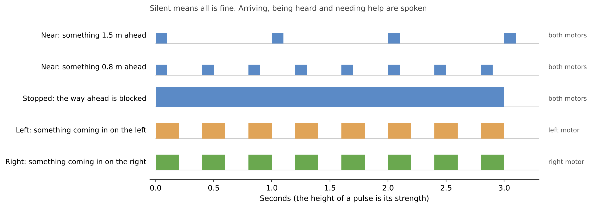

*Figure 24. The Four Vibration Signals Over Three Seconds*

The 8081 page shows the live colour camera with the red box, a Stage 1 strip coloured by the danger level (level, distance and camera status), and the Stage 3 map next to the camera picture, or below it on a phone. On the map, light grey is floor the LiDAR has seen, dark is a wall or object, mid grey is not seen yet, and the device is an orange dot with an arrow for the way it faces. Saved places are blue dots, signs and rooms purple, and things green, each with its name. A 1 m grid and a scale bar make distances readable. Under the picture are a text box and the buttons Ask once, Listening mode (works like the handle button), Track, Stop and Sound on. One line below them says what the device is doing, for example "Guiding to the door, 3.2 m to go", with the last sentence it said. Stage 1's beeps were switched off on 26 October because they were too annoying in use. The grip's vibration took their place.

## Design Decisions Made During the Build

The first design was written in September, before most of the device existed. Building it stage by stage changed several parts of it. Table 9 lists each change and the reason.

| **Part** | **Original design** | **As built** | **Why it changed** |
|----------------|----------------------|----------------------|------------------------------|
| Naming things and reading signs | YOLOv8 on the Jetson for objects, Tesseract OCR for signs | One vision-language model, Qwen3-VL-4B, on a campus PC. It finds a thing, reads a sign or answers a question about the picture | A YOLO model trained on COCO has no classes for doors or room signs. One model does all three jobs, and on the Jetson it was too slow with Stage 1 running (6.3 s an answer) |
| Understanding the user | Wake word or button; ChatGPT API for intent | Hold-to-talk button only; Whisper turns speech into words; "take me to" and the map commands are picked out by their words, other questions are sorted by Qwen | The campus network blocks the links a cloud service needs. A button has no false triggers. The fixed commands are faster and never depend on a model's mood |
| Sound | SHOKZ bone conduction headset over Bluetooth | The device's web page plays the voice and records the question on a laptop or phone | The headset was never ordered, and Bluetooth earphones made the Jetson's Wi-Fi unusable |
| Knowing how far it moved | Inertial sensor and wheel counters | The LiDAR alone, by lining up each sweep with the last | The motors came without wheel counters and the camera is a D435, with no motion sensor. The cost is drift in tight spots |
| Mapping | Visual SLAM with LiDAR fusion | RTAB-Map with the LiDAR; the camera adds low obstacles for the route; the team's own map manager saves, loads and places the device | RTAB-Map's own placing on a loaded map did not work. The LiDAR map was already accurate in the lab |
| Route and driving | Path planning on the map | Nav2 plans the route and its Regulated Pure Pursuit follower drives it; the hazard gate can stop it | Standard, tested packages; the team's effort went into the safety checks round them |
| Microcontrollers | One ESP32 on a USB cable | Three: the Stage 1 sensor board and the master on USB, and the grip in the handle on an ESP-NOW radio link | The grip was built as a closed wireless unit, and the wheels needed a board that can stop them by itself |
| Vibration | Three motors in the grip, stronger when closer | Two motors and four signals: near, stopped, left and right; silent otherwise | "Stronger when closer" buzzed nearly all the time indoors and told the user nothing. Seven signals with a meaning were tried next and were too many to learn |
| Guidance | Turn-by-turn speech (requirement FR6.1) | The steering and the grip say left and right; speech is kept for the start, the arrival and hold-ups | A pull on the handle is quicker to follow than a sentence, and leaves the ears free |
| Free exploration | Obstacle alerts with no destination (requirement FR5.2) | The user pushes; the grip warns; the device can also turn the user away, without ever driving forward | Asked for by the team lead on 15 November; turning only is what makes it safe |
| Places on the map | Detections and sign text attached as the user walks (requirements FR3.1 and FR4.4) | A labeller asks the AI for signs and landmarks every few steps and pins them after two looks | It uses the model the device already has, and two looks filter out one-off mistakes |
| Emergency stop | Wired straight to the motor driver power, and kept off any wireless link | The green button in the grip, sent over the radio link and acted on by the master ESP32's own program | The grip has no wire to the base. The risk the design wanted to avoid is covered the other way round: if the grip is silent for 0.3 s, the master stops the wheels, so a lost link stops the device too. A wired cut-off switch on the base is still worth adding |
| Power | One 12 V, 12 Ah LiFePO4 battery for everything | A 12 V battery for the motors and a separate power pack for the Jetson | Motor current stays away from the computer's supply |

*Table 9. Changes Made During the Build and the Reasons*
